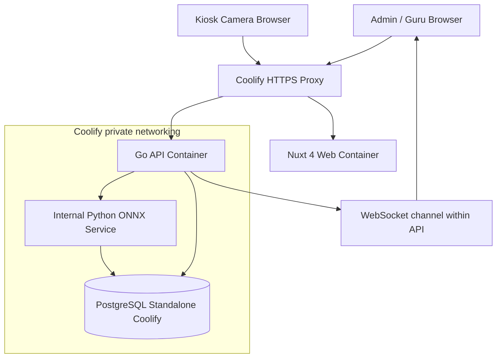
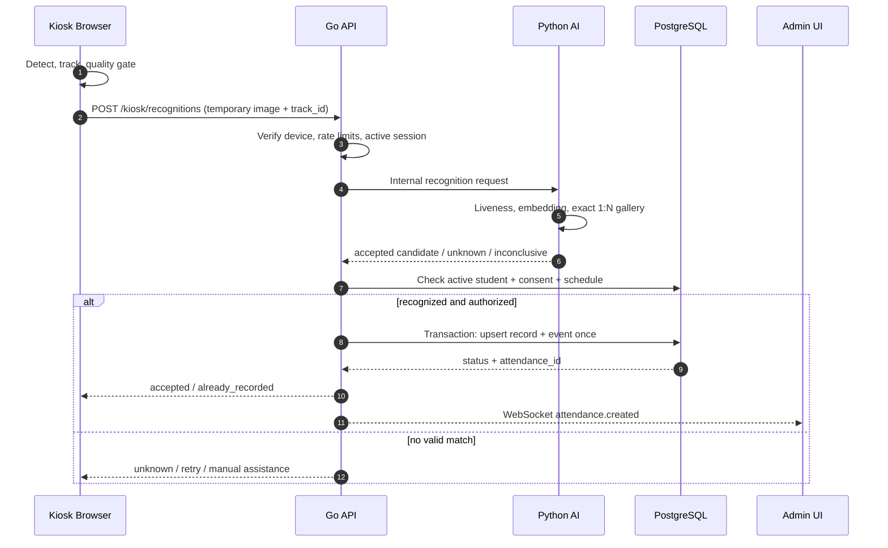
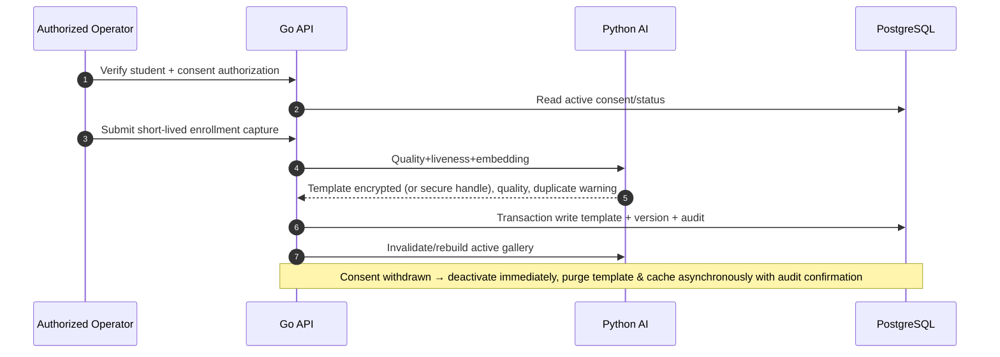

# 02 — System Architecture & Engineering Blueprint

## 1. Prinsip

- **Modular monolith Go + separate AI microservice**, bukan microservices untuk semua fitur.
- Identifikasi otomatis **open-set 1:N** dengan opsi reject; tidak ada input nama/QR.
- Pemrosesan kamera hanya di area yang memang ditetapkan untuk absensi.
- Minimasi data: frame sementara, embeddings disimpan terenkripsi, metadata recognition singkat.
- Fail-safe: jika AI/jaringan/consent invalid → review/manual, **tidak** auto-presence.
- Deployment aplikasi hanya berisi tiga container: `web`, `api`, `ai`; PostgreSQL *standalone resource* Coolify.

## 2. Container context



> Compose contoh mengasumsikan resource berada di satu Docker network privat yang dapat saling resolve. Di Coolify, koneksi lintas resource perlu jaringan/DNS yang secara eksplisit sudah diverifikasi; nama host contoh tidak boleh di-hardcode tanpa pemeriksaan.

## 3. Modul Go

| Modul | Service responsibility |
|---|---|
| `auth` | Sessions, password hashing, policies |
| `school` | Profil & timezone |
| `students` | CRUD, import, status, PII controls |
| `academics` | Academic years, classes, enrollments, teacher assignments |
| `consent` | Legal gate, consent history, withdrawal |
| `biometrics` | Enrollment coordination, lifecycle, gallery invalidation |
| `devices` | Provisioning, rotation/revoke, camera status |
| `attendance` | Sesi, absensi, business rules, idempotency, manual & corrections |
| `reporting` | Aggregates/filter exports |
| `audit` | Security/audit events |
| `realtime` | Event delivery & authorization |

Folder modul menyimpan `handler`, `service`, `repository` dan `model` seperlunya. Jangan membuat layer abstraksi generik tidak terpakai. Transaction scope hanya ada di Go attendance module.

## 4. Sequence — automatic check-in



Key privacy property: Python never returns candidate lists with identity to kiosk; Go accepts only signed/internal results. Capture images are held only in request memory; no body logging or disk temp files by default.

## 5. Sequence — enrollment/revocation



Revocation should deactivate matching synchronously in access control, then purge storage/cache with monitored job. If purge fails, keep biometric route blocked and alert operator.

## 6. Recognition algorithm policy

1. Browser detects/track multiple faces and quality gates size, orientation, blur, illumination.
2. Sample a frame when quality adequate; rate limit per temporary track; do not send all frames.
3. Server validates device identity, active session, time, origin, image type/size, and replay nonce.
4. Python rejects ambiguous/multiple/low-quality inputs and spoof-suspected probes.
5. Model produces normalized embedding; gallery contains only active/authorized identities from this school.
6. Exact cosine similarity scans active templates; evaluate calibrated threshold and separation margin from runner-up.
7. Decision must persist for multiple observations of same track prior to auto-check-in, with TTL.
8. Unknown/inconclusive never gets a name or attendance record automatically.
9. Template version/model ID strictly match; re-enrollment needed if embedding model changes incompatibly.
10. Never present raw similarity score to kiosk or use it as a probability of truth.

## 7. Multi-face / throughput

Tracked faces are handled independently. A single detected frame may contain multiple students, but request budgets and independent stable match decisions apply. Pilot must prove whether this is supported at acceptable throughput; otherwise guide students to one-person capture zone.

Performance experiments: 30 FPS video display ≠ 30 AI inferences/s. Start 3-5 detection checks/s per kiosk and ≤1 recognition request/s per face track, tune with P95 latency, device CPU/RAM, model throughput, frame bandwidth. These are starting settings, not measurements.

## 8. Failure modes

| Failure | Behavior |
|---|---|
| Camera denied | Show remediation; kiosk offline badge; manual attendance |
| AI down / timeout | No auto attendance; backoff; alert operator |
| DB unavailable | No fake success; manual secure procedure; reconciliation |
| Network intermittent | Drop temporary frames; DO NOT cache photos/embedding locally |
| Consent revoked | Immediately exclude from active matching gallery |
| Low light / occlusion | Retry with guidance; switch manual if persistent |
| Duplicate/replay | Server idempotent response `already_recorded` |
| Same student multiple kiosks | Database unique constraint + transactional lock handles race |
| Inaccurate match suspicion | Freeze auto-approval & require manual review |

## 9. Attendance transaction (pseudocode)

```text
BEGIN
  validate active device, school, schedule, student, consent at event time
  INSERT attendance_events(event_id, device_id, ...) ON CONFLICT DO NOTHING
  if event already exists: read current attendance record; return idempotent response
  INSERT attendance_records(session_id, student_id, first_seen_at, status)
    ON CONFLICT (session_id, student_id)
    DO UPDATE only when allowed by explicit check-in/check-out state rules
  INSERT audit_entries ...
COMMIT
publish sanitized attendance.created event AFTER commit
```

Use **transactional outbox** only when delivery guarantees justify it; MVP can use in-process publish plus client refetch/reconciliation. WebSocket is a convenience channel, not the source of truth.

## 10. Repository structure

```text
school-face-attendance/
├── apps/
│   └── web/                        # Nuxt 4
│       ├── app/
│       │   ├── pages/{login,admin,kiosk}/
│       │   ├── components/{ui,layout,students,attendance,camera,reports}/
│       │   ├── composables/
│       │   ├── stores/
│       │   ├── middleware/
│       │   └── assets/css/
│       ├── nuxt.config.ts
│       └── Dockerfile
├── services/
│   ├── api/
│   │   ├── cmd/api/
│   │   ├── internal/{auth,students,academics,biometrics,attendance,devices,reporting,audit}/
│   │   ├── internal/platform/{config,db,http,security,events}/
│   │   ├── migrations/
│   │   ├── go.mod
│   │   └── Dockerfile
│   └── ai/
│       ├── app/{api,engines,recognition,enrollment,security,metrics}/
│       ├── tests/
│       ├── pyproject.toml
│       └── Dockerfile
├── deploy/
│   ├── compose.application.yml
│   └── .env.example
├── docs/
│   ├── prd.md
│   ├── design.md
│   ├── architecture.md
│   └── api.md
├── scripts/
└── README.md
```

## 11. Tech tradeoffs & ADRs

- ADR-001: Nuxt 4 + shadcn-vue for Vue UI; avoid React-only shadcn copy/paste.
- ADR-002: Go monolith owns school data/attendance transactions; avoids distributed saga complexity.
- ADR-003: Python isolated AI runtime; allows replacing model without reworking attendance logic.
- ADR-004: Embedding encryption application-side and exact secure gallery in memory first; avoids exposed queryable biometric database for MVP.
- ADR-005: PostgreSQL standalone managed Coolify; not duplicated within application compose.
- ADR-006: WebSocket is ephemeral event delivery; REST/requery is canonical state.
- ADR-007: No autonomous negative attendance consequences; manual review mandatory.

## 12. Scaling pathway

1 kiosk/500 users → exact in-memory matching and Go transaction. At 5+ kiosks or 10k+ active students, benchmark AI worker pool / GPU and model concurrency. Evaluate partitioned gallery, controlled ANN (pgvector only if extension available in Coolify database), async event buffering with encrypted payload only if requirements demand. Multi-school tenancy requires enforceable tenant policies and an isolation audit before launch.
