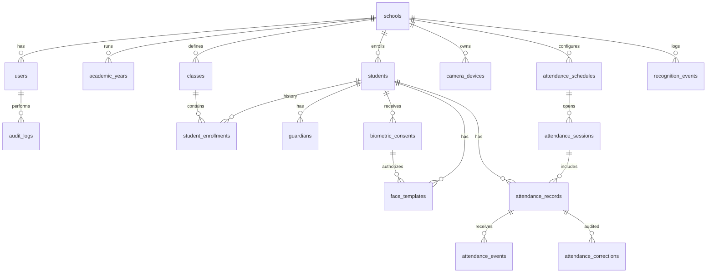

> Pembaruan implementasi 15 Oktober 2026: alur wali/persetujuan wajah telah dihentikan sesuai keputusan pemilik proyek (migrasi 11). ID persetujuan lama hanya dipertahankan sebagai konteks enkripsi template lama. Bagian blueprint berikut yang masih menyebut alur tersebut adalah rancangan awal; kontrak aktif mengikuti kode/OpenAPI dan [runbook staging](docs/STAGING-RUNBOOK.md).

# 04 — Database & Data Dictionary

## 1. Penyimpanan

PostgreSQL pada **Database Service resource Coolify**, tidak ada DB dalam compose app. Raw video dan gambar wajah **tidak** disimpan default. Template embedding disimpan **sebagai ciphertext terenkripsi oleh aplikasi** (`bytea`), dengan key di luar DB. Untuk gallery kecil, AI memuat template valid ke memory secara terkontrol untuk matching; tidak ada `pgvector` dalam migration dasar.

## 2. ERD inti

## 3. Core data dictionary

| Tabel | Kolom utama | Constraint / catatan |
|---|---|---|
| `schools` | id, name, timezone, is_active | satu sekolah MVP |
| `users` | id, school_id, email, password_hash, role, is_active | unique email per sekolah, hash Argon2id |
| `academic_years` | school_id, name, starts_on, ends_on | non-overlap via app rules |
| `classes` | school_id, code, name, level | unique code per school |
| `students` | school_id, nis, nisn(nullable), full_name, status | unique `(school_id, nis)` |
| `student_enrollments` | student_id, class_id, academic_year_id, joined_at, left_at | unique within year per student (MVP) |
| `guardians` | student_id, name, contact_encrypted (nullable), relationship | minimal data; mask display |
| `biometric_consents` | student_id, guardian_id, status, signed_at, withdrawn_at, notice_version, evidence_ref | immutable history; evidence safeguarded |
| `face_templates` | student_id, consent_id, model_version, dimension, ciphertext, nonce, key_version, status | encrypted, no plain embeddings |
| `camera_devices` | school_id, device_code, status, last_seen_at, secret_hash | no secrets in clear |
| `attendance_schedules` | school_id, name, checkin_start, checkin_cutoff, close_time, timezone | times defined in local zone |
| `attendance_sessions` | schedule_id, session_date, opens_at, closes_at, status | unique schedule/date, UTC timestamps |
| `attendance_records` | session_id, student_id, status, check_in_at, check_out_at, source | unique session/student |
| `attendance_events` | attendance_record_id, event_uuid, event_type, device_id, event_at | append-only, unique event UUID |
| `recognition_events` | school_id, device_id, decision, matched_student_id nullable, model_version, created_at | short retention, no face crop |
| `attendance_corrections` | record_id, requested_by, approved_by, reason, previous/new values | no silent rewriting |
| `audit_logs` | school_id, actor_id, action, target_type, target_id, occurred_at, metadata | metadata redacted |

## 4. Status enums (stored as CHECK constraints in base SQL)

- Student: `active`, `inactive`, `graduated`, `transferred`.
- Consent: `granted`, `withdrawn`, `expired`, `denied`.
- Template: `active`, `suspended`, `revoked`.
- Attendance session: `scheduled`, `open`, `closed`, `cancelled`.
- Attendance record: `present`, `late`, `excused`, `sick`, `absent`, `pending_review`.
- Event type: `check_in`, `check_out`, `manual_adjustment`.
- Recognition decision: `accepted`, `unknown`, `inconclusive`, `spoof_suspected`, `rejected`.

## 5. Attendance transaction

- Backend derives all identity from AI **internal** result, not from external client claim.
- Insert recognition request id with bounded TTL / replay protection. Use DB unique constraint for events.
- A student/session row is unique; duplicate check-in yields `already_recorded`. Check-out may update same summary row while adding new event.
- Any permission/consent/school/session mismatch must abort transaction.
- Reports query attendance records with class join through academic_year placement; filter assigned teacher server-side.
- No absence auto-generation until session is closed & reconciliation complete.

## 6. Indexing & multi-school readiness

Index FKs and common query patterns: `(school_id, nis)`, `(school_id, status)`, `(session_id, student_id)`, `(student_id, recorded_at)`, `(device_id, created_at)`. Database tenant isolation via school-level query guard, optional PostgreSQL Row Level Security after a threat model review. All future multi-school queries must have school scope.

## 7. Data lifecycle

- Enrolment rejected: no template created.
- Consent withdrawn: disable match immediately; purge ciphertext and in-memory gallery; record non-sensitive evidence of deletion.
- Student graduated/transferred: suspend template and delete according to policy; attendance records retained only as legally needed.
- Raw image: discarded after inference, no logs or backups.
- Unknown recognition metadata: retention short, e.g. 1–7 days policy-defined; no identity linking.
- Attendance data: school retention schedule + legal review; example duration not pre-imposed.
- Backup encryption, restoration and deletion from backup lifecycle must be documented before launch.

## 8. SQL file limitations

`schema.sql` berisi baseline relations, constraints, dan index; tidak menyediakan seluruh prosedur akses RBAC, key management, trigger historis, migration rollback, atau materialized aggregate. Untuk produksi gunakan versioned migrations + review penegakan cross-school foreign keys dan integritas audit.
