> Pembaruan implementasi 15 Oktober 2026: alur wali/persetujuan wajah telah dihentikan sesuai keputusan pemilik proyek (migrasi 11). ID persetujuan lama hanya dipertahankan sebagai konteks enkripsi template lama. Bagian blueprint berikut yang masih menyebut alur tersebut adalah rancangan awal; kontrak aktif mengikuti kode/OpenAPI dan [runbook staging](docs/STAGING-RUNBOOK.md).

# 06 — Security, Privacy, Legal & Biometric Safety

> Rancangan teknis, bukan pendapat hukum. Konsultasikan dengan penanggung jawab PDP/hukum sekolah sebelum pilot biometrik siswa.

## 1. Kepatuhan dan tata kelola

UU No. 27 Tahun 2022 menempatkan **data biometrik dan data anak sebagai data pribadi spesifik**. Pemrosesan data anak memerlukan kontrol persetujuan orang tua/wali; pemrosesan berisiko tinggi memerlukan penilaian dampak perlindungan data. Dasar pemrosesan dan kebebasan persetujuan dalam konteks relasi sekolah-anak perlu dianalisis secara khusus; jangan menganggap checkbox sudah cukup. Portal hukum primer: https://peraturan.bpk.go.id/Details/229798/uu-no-27-tahun-2022.

**Dokumen governance wajib sebelum uji dengan anak:** data flow inventory; tujuan spesifik pemrosesan; notifikasi; legal basis; kebijakan consent dan withdrawal; Data Protection Impact Assessment (DPIA); pembagian peran pengendali/prosesor; data processing agreement jika ada vendor; kebijakan retensi; prosedur subject rights; incident response; SOP koreksi dan jalur nonbiometrik.

**Alternatif setara:** kartu administratif yang diverifikasi petugas atau absensi manual tanpa biometrik. Siswa tidak boleh mendapat perlakuan negatif hanya karena menolak biometrik atau AI tidak mengenali wajah.

## 2. Threat model STRIDE ringkas

| Threat | Potensi penyalahgunaan | Mitigasi |
|---|---|---|
| Spoofing | Foto/video dipakai sebagai wajah | Liveness + quality + multi-frame + manual review |
| Tampering | Manipulasi hasil kamera atau request | TLS, device session, replay nonce, rate limits, server decision |
| Repudiation | Admin menyangkal koreksi | Audit immutable-ish, reason, actor, timestamps, approver |
| Information disclosure | Bocor gambar/embedding/identitas | No image retention, app-side encryption, least privilege, no public gallery |
| DoS | Burst upload frame / AI overload | Payload caps, queue backpressure, per-device quotas, timeouts |
| Privilege escalation | Guru baca seluruh biometrik | Server-side RBAC/class scope + sensitive operations segregation |
| Model poisoning | Enrollment salah identitas | Authorized capture, dedup review, enrollment audit, quality gate |
| Model license breach | Pakai pretrained model riset di produk berbayar | License checklist, model manifest, signed model artifacts |

**Liveness tidak 100% anti-spoofing.** Camera RGB saja mungkin tidak cukup untuk ancaman tingkat tinggi. Evaluasi hardware camera/liveness tambahan bila risk assessment menuntut.

## 3. Lifecycle biometrik

```mermaid
flowchart LR
  Notice[Pemberitahuan & dasar pemrosesan] --> Consent[Persetujuan wali / legal gate]
  Consent --> Enroll[Capture sementara]
  Enroll --> Encrypt[Embedding encrypted]
  Encrypt --> Match[Matching in secure memory]
  Match --> Revoke[Penarikan / masa akhir]
  Revoke --> Disable[Stop matching segera]
  Disable --> Purge[Purging DB cache + backup lifecycle]
  Purge --> Audit[Deletion evidence tanpa biometric payload]
```

- Jangan unggah/menyimpan rekaman kamera jangka panjang.
- Enkripsi *template* dengan AES-256-GCM per-record nonces; keys di secret manager/secure KMS, **di luar DB**.
- Pisahkan AI process dan database account. Secret rotation versi, decrypt only in protected process, clear on worker shutdown, caches with bounded TTL.
- Model-generated embeddings adalah biometrik; treat sama sensitifnya dengan gambar.
- Raw image tidak masuk structured logs, traces, crash reports, backups, media analytics.
- Audit consent withdrawal and successful purge; rollback feature must not re-enable revoked identities.

## 4. RBAC Matrix

| Feature | Super Admin | Admin | Teacher | Operator |
|---|:---:|:---:|:---:|:---:|
| Manage student data | Yes | Yes | View class | Limited |
| Register/revoke face | Scoped | With explicit grant | No | Enrollment only |
| Manage consent evidence | Yes | Scoped officer | No | Read eligibility only |
| View absences | All school | All school | Assigned classes | Assigned session |
| Manual attendance | Yes | Yes | Request | With permission |
| Approve correction | Yes | Designated approver | No | No |
| Manage camera devices | Yes | Yes | No | Health only |
| View audit security log | Yes | Limited | No | No |
| Export PII | Controlled | Controlled | Assigned class | No |

Auth details: Argon2id passwords, session rotation, rate limiting, optional TOTP/MFA for admins, cookies HttpOnly Secure SameSite and CSRF validation. User permission must be checked inside Go service and repository queries, never solely via UI.

## 5. Browser/kiosk security

- HTTPS required to access camera via `getUserMedia()` on non-local origins.
- Device browser is semi-trusted; **do not embed static API secrets in JavaScript**. Use short-lived, limited device session provisioned via operator authorization and restricted device/network controls. Kiosk session compromise must be revocable.
- Content Security Policy, restricted API CORS, dependencies pinned & scanned, strong upload size caps.
- End video tracks when enrollment completes/closes; distinguish `camera active` status visually.
- No frame upload outside scheduled purpose, no photos saved in localStorage/service worker caches.
- Public display does not show full name, NISN, DOB, contact, embedding scores or unknown face gallery.

## 6. Services and infrastructure

- Only Nuxt/Go API reachable via managed Coolify ingress; Python AI internal, PostgreSQL private. Block unnecessary host ports via firewall.
- Database credentials stored as Coolify secrets, scoped to principle of least privilege. Enable encrypted backups, test restores, consider WAL recovery requirements.
- Vulnerability scanner for images/packages, pinned base versions, CI secret detection, signed dependencies/models where possible.
- Logs: request IDs, error codes and durations only; redact PII, tokens, cookies, request bodies, image data, embeddings.
- Health checks on services without revealing application secrets. Resource limits for AI to avoid VPS exhaustion.
- Beware Coolify DB resource **runs in its own container behind the service abstraction**; requirement fulfilled by not bundling DB in app compose.

## 7. Audit, retention, incidents

**Audit:** user login/logout, student CRUD, enrollment, consent state change, admin override, export download, device revoke, model version update. No biometric material in audit rows. Restrict audit edits; export logs to tamper-resistant storage if regulation or risk requires.

**Retention:** defined by school policy and law. Default shortest practicable for recognition metadata; consent evidence may need longer retention than template; backups need deletion lifecycle. Do not hardcode years without legal basis.

**Incident response:** block compromised kiosk/session, revoke token, isolate AI, assess breach, preserve sanitized audit records, activate manual process, notify relevant stakeholders/regulator if applicable, rotate secrets, restore from verified backups.

## 8. AI evaluation before launch

Use consented adult volunteers or licensed data first; then limited student pilot only after approvals. Split enrollment vs evaluation samples, include unknown users and environmental conditions. Track 1:N **FPIR** and **FNIR**, P95 latency, spoof attack pass rate (APCER/BPCER where appropriate), subgroup performance where lawful/ethical and sample sufficient. No unqualified accuracy marketing claim. Threshold, model checksum and evaluation record must be versioned. Document false accept / false reject resolution workflow.

## 9. Mandatory go/no-go checks

1. DPIA and legal review approved, alternative attendance live.
2. No raw images retained beyond ephemeral inference without separate lawful purpose.
3. Template encryption, key rotation, and withdrawal/purge tested.
4. AI model license suitable for intended deployment; InsightFace public pretrained models should **not** be assumed commercially licensed.
5. Threat tests: replay/spoof/burst, permission bypass, tenant/class leak, duplicate race.
6. No negative student outcomes from uncertain recognition without a human review.
