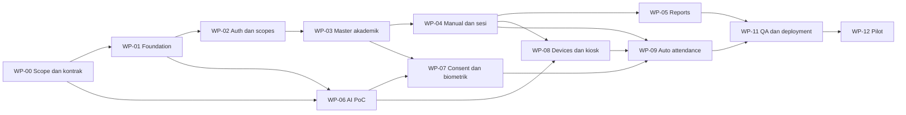

> Pembaruan implementasi 15 Oktober 2026: alur wali/persetujuan wajah telah dihentikan sesuai keputusan pemilik proyek (migrasi 11). ID persetujuan lama hanya dipertahankan sebagai konteks enkripsi template lama. Bagian blueprint berikut yang masih menyebut alur tersebut adalah rancangan awal; kontrak aktif mengikuti kode/OpenAPI dan [runbook staging](docs/STAGING-RUNBOOK.md).

# 07 — Analisis Project dan Rencana Implementasi

Tanggal: 12 Oktober 2026 · Produk: School Face Attendance

Status awal 12 Oktober: rencana untuk review. Pengguna kemudian menyetujui implementasi bertahap dan pada 13 Oktober meminta melanjutkan seluruh plan di lokal; pilot dan deployment Coolify belum disetujui/dijalankan. Status aktual ada di [ledger kelanjutan](docs/LOCAL-COMPLETION-PROGRESS.md). Dokumen ini dibuat dari analisis seluruh berkas project menggunakan pendekatan brainstorming: memahami tujuan, membandingkan pendekatan, menetapkan rekomendasi, memetakan gap, lalu menguraikan pekerjaan dan kriteria penerimaan.

## 1. Tujuan dan kondisi project

Tujuan produk adalah mempercepat absensi sekolah melalui pengenalan wajah 1:N, dengan data siswa terpusat, laporan yang dapat diaudit, serta absensi manual yang setara. Keberhasilan bukan hanya kamera mengenali wajah: status kehadiran harus benar, tidak ganda, dapat dikoreksi, dan hanya dapat dibaca oleh pengguna berwenang.

**Fakta hasil pemeriksaan:** direktori berisi enam dokumen Markdown. Belum ada source code, manifest dependencies, migration SQL, konfigurasi deployment, atau test executable. Direktori ini juga belum merupakan repository Git. Struktur folder dan snippet pada blueprint adalah usulan, bukan implementasi yang sudah berjalan.

| Sumber | Cakupan yang dianalisis | Implikasi untuk rencana |
|---|---|---|
| [01-PRD.md](01-PRD.md) | Persona, J-1–J-5, FR-01–FR-18, NFR-01–NFR-10 | Scope, prioritas, business rules, acceptance |
| [02-ARCHITECTURE.md](02-ARCHITECTURE.md) | Go monolith, Python AI, Nuxt, sequence, ADR | Batas modul, integrasi, deployment |
| [04-DATABASE.md](04-DATABASE.md) | ERD, dictionary, status, transaksi, lifecycle | Migration, integrity, histori, retensi |
| [05-API.md](05-API.md) | REST, kiosk, internal AI, WebSocket, errors | Kontrak publik/internal dan coverage endpoint |
| [06-SECURITY.md](06-SECURITY.md) | RBAC, consent, encryption, evaluasi, governance | Acceptance keamanan dan syarat pilot dari project |
| [BLUEPRINT-LENGKAP.md](BLUEPRINT-LENGKAP.md) | Bagian 01–08, termasuk UI/UX, delivery/QA, hardware/SOP | Melengkapi bagian 03, 07, 08 yang belum menjadi berkas terpisah |

`schema.sql`, `admin-dashboard-preview.html`, dan ZIP yang disebut sumber tidak ditemukan. Rencana tidak mengasumsikan artefak tersebut sudah tersedia. Dokumen modular menjadi acuan per bidang; bagian tambahan blueprint menjadi acuan UI, QA, dan operasi. Konflik harus diputuskan melalui catatan keputusan sebelum coding bidang terkait.

**Asumsi perencanaan:** satu sekolah, hingga 500 siswa, 1–2 kiosk, Bahasa Indonesia, zona sekolah Asia/Jakarta, perangkat online saat pengenalan. Angka ini berasal dari target pilot dokumen dan harus dikonfirmasi sekolah. Estimasi waktu bukan tanggal rilis yang dijanjikan.

## 2. Hasil brainstorming: pilihan pendekatan

| Pendekatan | Kelebihan | Trade-off | Penilaian |
|---|---|---|---|
| A. Fondasi absensi manual + PoC AI berjalan sebagai dua jalur | Sistem berguna meski AI belum layak; risiko model dibuktikan dini | Memerlukan kontrak bersama agar integrasi konsisten | **Direkomendasikan** |
| B. Semua pekerjaan menunggu PoC AI selesai | Mengurangi investasi produk bila biometrik dibatalkan | Menunda manfaat master data dan manual attendance | Cocok bila keputusan pendanaan sepenuhnya bergantung pada AI |
| C. Semua fitur langsung dibangun sekaligus | Demo fitur cepat terlihat lengkap | Risiko mengulang DB/API/UI setelah model dan kebijakan berubah | Tidak dipilih |

Rekomendasi A mengikuti stack existing blueprint. Jalur produk membangun login, data akademik, sesi, manual attendance, koreksi, dan laporan. Jalur R&D membuktikan kamera, liveness, lisensi, matching, dan latency memakai data uji yang diizinkan. Keduanya bertemu setelah kontrak dan hasil evaluasi memadai. Ini urutan pekerjaan, bukan instruksi menjalankan agen paralel.

MVP wajib mencakup seluruh P0. Import, check-out, dan WebSocket adalah P1. Fail-closed saat offline tetap merupakan perilaku keselamatan sejak kiosk pertama, walaupun FR-17 diberi prioritas P1. Multi-face simultan menjadi eksperimen; pilot awal menggunakan zona satu orang sampai throughput dan ketepatannya terbukti.

## 3. Gap dan inkonsistensi yang perlu diselesaikan

| ID | Temuan dan sumber | Dampak | Rekomendasi penyelesaian | Prioritas |
|---|---|---|---|---|
| GAP-01 | DB menyebut `schema.sql`, tetapi file tidak ada | Tidak ada schema executable untuk diturunkan | Buat versioned migrations dari dictionary yang telah dilengkapi | P0 |
| GAP-02 | PRD/UX memerlukan pengguna, jadwal, hari libur, penempatan dan penugasan guru; API belum mencakup semuanya | Alur admin dan scope guru tidak dapat diimplementasikan lengkap | Tambahkan kontrak pada bagian 6 | P0 |
| GAP-03 | DB belum memuat teacher assignments, user/device sessions, kalender, purge jobs | Auth, scope, scheduler, dan deletion belum punya persistence | Tambahkan relasi pendukung pada bagian 5 | P0 |
| GAP-04 | PRD memakai `not_recorded`; enum DB tidak memilikinya | UI berisiko menghitung siswa tanpa record sebagai alfa | Jadikan `not_recorded` status hasil roster LEFT JOIN record, bukan status record tersimpan | P0 |
| GAP-05 | Arsitektur memasukkan event sebelum record, tetapi event DB membutuhkan FK record; nama `first_seen_at`/`audit_entries` berbeda dari dictionary | Pseudocode tidak dapat langsung menjadi transaksi | Gunakan request ledger → record → event → `audit_logs`; gunakan `check_in_at` | P0 |
| GAP-06 | DB menyarankan index `recorded_at`, tetapi kolom itu belum didefinisikan; API memakai `updated_since` tanpa `updated_at` | Migration dan refetch incremental tidak konsisten | Definisikan timestamp per tabel serta index dari query nyata | P0/P1 |
| GAP-07 | `stable_match` ada pada hasil AI, tetapi request internal belum memuat konteks track/observasi | Stabilitas bisa sekadar dipercaya dari client atau tidak terbukti | AI menyimpan observasi sementara berdasarkan school/device/session/track, TTL dan versi gallery | P0 |
| GAP-08 | Crop tunggal belum menjelaskan kebutuhan multi-frame liveness; rate awal ≤1 request/detik dan stabilitas dapat menekan target 2 detik | Liveness dan latency berpotensi bertentangan | PoC menetapkan protocol temporal, jumlah observasi, dan budget latency; ukur end-to-end | P0 |
| GAP-09 | Withdrawal harus langsung mengecualikan gallery, tetapi sequence memakai purge async | Cache lama bisa tetap mengenali kandidat yang dicabut | Bedakan blok transaksi Go, invalidasi gallery, ACK revision, dan purge storage; gallery stale fail-closed | P0 |
| GAP-10 | Pemilik enkripsi dan akses DB AI belum tegas | Key access terlalu luas atau plaintext melewati boundary | AI mengenkripsi/dekripsi; Go menyimpan ciphertext; AI hanya read gallery yang diizinkan | P0 |
| GAP-11 | Unique student/year membatasi perpindahan kelas di tahun sama; laporan hanya join penempatan | Histori kelas dan scope guru berpotensi salah | Penempatan berinterval tanpa overlap; snapshot peserta dan penempatan saat sesi | P0 |
| GAP-12 | API `/students/{id}/enrollments` berarti biometrik, sementara `student_enrollments` berarti akademik | Implementasi dan SDK rawan tertukar | Pertahankan endpoint draft dengan schema eksplisit biometric; gunakan `/placements` untuk akademik | P0 |
| GAP-13 | RBAC security mengizinkan audit terbatas untuk admin; API hanya super admin; “Scoped” pada POST kelas ambigu | Kebocoran atau perbedaan izin UI/server | MVP audit super admin saja; POST/PATCH akademik hanya admin dengan grant | P0 |
| GAP-14 | Contoh unknown tidak punya `request_id`; 422 spoof versus decision spoof belum dibedakan | Client handling tidak konsisten | Semua JSON memiliki request_id; bedakan hasil domain dari error HTTP | P0 |
| GAP-15 | Import belum menentukan umur dry-run, perubahan file, atau retry commit | Preview bisa berbeda dari hasil commit dan menghasilkan duplikat | Hash payload, expiration, revalidasi, atomic commit, idempotency | P1 |
| GAP-16 | Gallery/model, replay window, retention, RPO/RTO belum memiliki nilai final | Engineering tidak dapat membuktikan batas operasional | Catat pemilik keputusan dan syarat validasi pada bagian 11 | P0 |

Semua rekomendasi gap adalah keputusan usulan. Dokumen sumber belum diubah; saat disepakati, update sumber terkait agar tidak muncul dua kontrak berbeda.

## 4. Arsitektur target dan tanggung jawab

Tetap gunakan Nuxt 4 + shadcn-vue/Tailwind v4, modular monolith Go, Python inference berbasis ONNX, serta PostgreSQL standalone resource Coolify. Framework HTTP Go, model, dan engine liveness belum dipilih oleh sumber; putuskan setelah PoC dan kebutuhan kontrak, bukan dengan menambah dependency secara spekulatif.

| Unit | Tanggung jawab | Interface/dependency |
|---|---|---|
| Web admin/guru | Form, master data, manual attendance, laporan | REST Go; UI tidak menjadi sumber otorisasi |
| Web kiosk | Kamera, deteksi/tracking, panduan, upload sementara | Device session dan recognition Go; tanpa secret statis |
| Go auth/platform | Sessions, RBAC, school/class/device scope, request IDs | PostgreSQL, cookie, CSRF |
| Go academics/students | Tahun ajar, kelas, penempatan, roster, teacher assignments | Repository scoped; histori tidak ditimpa |
| Go attendance | Kalender, sesi, transaksi check-in, koreksi, rekonsiliasi | PostgreSQL; hasil AI hanya kandidat internal |
| Go consent/biometrics | Legal eligibility, enrollment coordination, withdrawal, purge | Ciphertext storage dan internal AI lifecycle |
| Go devices/reporting/audit | Provision/revoke, filtered export, audit | Scope server-side, append-only audit |
| Python AI | Quality/liveness, embedding, exact matching, stable observations, gallery | Internal API; restricted gallery DB read; key di luar DB |
| Go background jobs | Session lifecycle, rekonsiliasi, purge/retry, retention | Job table PostgreSQL; proses dalam container api untuk MVP |

Go menjadi pemilik seluruh write business data. Setiap modul boleh memakai transaksi untuk perubahan atomik bidangnya: students+placement, consent+purge job, correction+record+audit. Pernyataan sumber “transaction scope hanya di attendance” perlu disempurnakan agar tidak menghalangi atomicity modul lain. Python tidak menulis attendance atau mengubah consent.

Enkripsi yang diusulkan: AI menghasilkan ciphertext AES-GCM dan metadata versi; Go tidak menerima embedding plaintext. AI memakai key yang tersedia melalui secret provisioning terkontrol dan hanya memuat template eligible dari gallery view/query terbatas. Bind school/student/model/key version sebagai authenticated metadata; batasi izin DB AI. Model files dipin checksum dan license manifest.

### 4.1 Alur otomatis

1. Kiosk aktif hanya pada sesi dan device yang sah; ambil crop berkualitas, tanpa penyimpanan foto lokal.
2. Go memverifikasi credential device, scope, input, rate limit, event UUID dan waktu penerimaan.
3. Go meneruskan image beserta trusted school/device/session/track context, model version dan gallery revision ke AI.
4. AI melakukan quality, liveness, exact 1:N, threshold/margin, dan stabilitas lintas observasi. Track dari browser hanya correlation hint, bukan bukti identitas.
5. Go memeriksa ulang siswa, consent, model/gallery revision, device, dan sesi sebelum commit. Server receive time menjadi dasar jam hadir; `captured_at` hanya validasi freshness/diagnostik.
6. Satu transaksi menulis summary, event dan audit secara idempotent. Kiosk mendapatkan sukses hanya setelah commit.
7. Dashboard mendapat event setelah commit. REST/refetch tetap sumber kebenaran.

AI memakai state track sementara di memory untuk satu instance MVP. Worker pool berikutnya memerlukan affinity atau shared state yang dirancang terpisah. Jangan menganggap flag `stable_match` dari frontend sah.

### 4.2 Withdrawal dan kegagalan

Withdrawal atomik menandai consent tidak eligible, menonaktifkan template, menaikkan gallery revision, dan menjadwalkan purge. Transaksi recognition mengambil lock pada eligibility yang sama dan memeriksa state terbaru untuk menutup race dengan withdrawal. Urutan lock harus konsisten untuk menghindari deadlock.

Gallery invalidation wajib mendapat ACK revision. Bila sinkronisasi gagal, matikan recognition untuk school tersebut sampai gallery valid; manual attendance terus tersedia jika API/DB sehat. Setiap request AI harus menolak revision lama. Purge menghapus ciphertext dan cache dengan retry terpantau; tombstone nonbiometrik dipakai untuk mencegah restore backup mengaktifkan data yang sudah dicabut.

AI timeout/kamera/jaringan bermasalah tidak boleh menghasilkan attendance atau status alfa. Jika API/DB down, operator memakai SOP administratif offline dan melakukan input/reconciliation setelah pulih; ini berbeda dari API manual yang masih membutuhkan DB.

## 5. Rencana database dan integritas

### 5.1 Urutan migration

| Batch | Relasi | Kriteria penerimaan |
|---|---|---|
| DB-01 | schools, users, user_sessions, permission_grants | Email unik school, password hash, expiry/revoke, bootstrap admin sekali pakai |
| DB-02 | academic_years, classes, students, student_enrollments, teacher_assignments | NIS unik, school FK konsisten, penempatan tidak overlap, histori guru/kelas |
| DB-03 | school_calendar_days, attendance_schedules, attendance_sessions, attendance_session_participants | Hari libur, jadwal UTC/local, unique schedule/date, snapshot roster |
| DB-04 | attendance_records, attendance_events, attendance_corrections, request_ledger, audit_logs | Unique session/student, event UUID unik, corrections terotorisasi, retry aman |
| DB-05 | guardians, biometric_consents, face_templates, biometric_purge_jobs, biometric_tombstones, gallery_state | Eligibility traceable, ciphertext only, revision invalidation, purge evidence |
| DB-06 | camera_devices, device_sessions | Provision hash, short-lived sessions, instant revoke, school/session binding |
| DB-07 | recognition_events; import_batches untuk P1 | Metadata terbatas/retention, immutable import payload dan retry commit |

Daftar tabel pendukung merupakan tambahan usulan, bukan tabel existing. Tambahkan `school_id` pada relasi penting atau enforce hubungan melalui parent key; gunakan composite FK ketika perlu memastikan dua referensi berasal dari sekolah yang sama. UUID global tidak cukup mencegah salah scope.

### 5.2 Aturan yang harus dipastikan

- `student_enrollments` memakai interval efektif; unique student/year diganti integritas no-overlap untuk mendukung pindah kelas dalam tahun sama. Placement berikutnya tidak mengubah roster historis.
- `attendance_session_participants` menyimpan student, placement, dan kelas saat sesi. Late addition/removal membutuhkan alasan dan audit. Scope laporan historis mengikuti aturan assignment guru yang disepakati.
- `not_recorded` diturunkan dari snapshot roster tanpa attendance record. Job finalisasi hanya menghasilkan `absent` setelah sesi closed dan reconciliation selesai; izin/sakit tetap dipertahankan.
- Attendance menggunakan `check_in_at`, `check_out_at`, `created_at`, `updated_at`. Semua timestamp UTC `timestamptz`, tanggal sesi diturunkan dari timezone sekolah.
- Event dan audit append-only untuk akun aplikasi biasa. Audit write berada dalam transaksi perubahan utama. Detail error/log tidak memuat foto, template, password, cookie, atau consent evidence.
- Constraint status mengikuti dictionary. Tambahkan state correction `pending/approved/rejected` dan purge `queued/running/succeeded/failed` secara eksplisit.
- Index dibangun berdasarkan query scoped: session/student, school/status, class/date melalui roster, device/created_at, serta updated_at/id untuk refetch. Jangan membuat index pada kolom yang belum ada.

### 5.3 Transaksi attendance yang direncanakan

1. Mulai transaksi dan reserve `request_ledger` dengan key school/device/operation/event UUID serta fingerprint payload. Scope menyertakan user untuk operasi manual.
2. Retry identik mengambil hasil sebelumnya; UUID sama dengan payload/operation berbeda ditolak. Upload observasi berikutnya memakai event UUID baru pada track yang sama.
3. Lock dan recheck eligibility, device, participant dan session. Recognition yang belum accepted tidak membuat record kehadiran.
4. Insert attendance record bila belum ada; lock record existing. Jangan menimpa izin/sakit/koreksi tanpa state rule; arahkan conflict ke review.
5. Check-in berulang membaca record dan menghasilkan `already_recorded`; tidak menambah event check-in atau mengganti jam pertama. Event check-out P1 menambah event pada summary yang sama.
6. Insert attendance event setelah record tersedia; tulis audit dan hasil idempotency; commit.
7. Publish event sesudah commit. Race dua device dicegah oleh unique session/student dan row lock; event UUID berbeda tetap tidak menggandakan check-in.

Ledger untuk keputusan recognition non-accepted hanya memuat metadata/hasil tersanitasi dengan TTL, bukan image atau embedding. Penghapusan ledger tidak menghapus unique constraint attendance/event permanen. Batas retry, TTL dan payload cap harus ditentukan sebelum endpoint recognition dibangun.

## 6. Rencana API dan kontrak

Pertahankan prefix `/api/v1`. Tulis OpenAPI publik dan internal **sebelum** integrasi frontend/backend untuk menyelesaikan ambiguitas. Ini penyempurnaan urutan dari draft yang baru menyebut generation setelah handler dibuat. CI harus membandingkan implementasi dengan schema agar kontrak tidak drift.

### 6.1 Coverage endpoint draft

| Kelompok | Endpoint dalam 05-API.md | Paket |
|---|---|---|
| Auth | POST login/logout, GET me | WP-02 |
| Students | GET/POST students; GET/PATCH students/{id} | WP-03 |
| Academic | GET/POST classes dan academic-years | WP-03 |
| Attendance | GET attendance-sessions, GET attendances, POST attendances/manual | WP-04 |
| Corrections | POST attendance-corrections, POST {id}/decision | WP-04 |
| Reports/dashboard | GET dashboard/summary, reports/attendance | WP-05 |
| Consent | GET/POST students/{id}/consents, POST consents/withdraw | WP-07 |
| Biometric enrollment | POST students/{id}/enrollments, GET face-status | WP-07 |
| Devices/kiosk | GET/POST devices, POST devices/{id}/revoke, POST kiosk/session | WP-08 |
| Recognition | POST kiosk/recognitions | WP-09 |
| Audit | GET audit-logs | WP-02/WP-05 |
| AI internal | POST /internal/v1/recognize | WP-06/WP-09 |
| Imports | POST students/imports/dry-run, POST students/imports/{id}/commit | WP-10, P1 |
| Realtime | GET ws/attendance (upgrade) | WP-10, P1 |

Endpoint auth, students, dan lainnya di tabel menggunakan prefix yang sama; endpoint internal AI tidak dipublikasikan di ingress.

### 6.2 Tambahan kontrak yang diusulkan

| Method/path relatif `/api/v1` | Tujuan dan batas izin | Prioritas |
|---|---|---|
| GET/PATCH `/school/settings` | Timezone/config; read scoped, write admin dengan grant | P0 |
| GET/POST `/users`; PATCH `/users/{id}` | User/role/status; super admin, grant terkontrol | P0 |
| PATCH `/classes/{id}`; PATCH `/academic-years/{id}` | Edit/arsip akademik; admin; histori tidak dihapus | P0 |
| GET/POST `/students/{id}/placements` | Histori dan penempatan siswa; read class scope, write admin | P0 |
| GET/POST `/teacher-assignments`; PATCH `/{id}` | Kelas/tahun/interval guru; admin | P0 |
| GET/POST `/attendance-schedules`; PATCH `/{id}` | Jam, cutoff, grace, close; admin | P0 |
| GET/PUT `/school/calendar/{date}` | Hari efektif/libur; admin write | P0 |
| POST `/attendance-sessions/{id}/open` dan `/close` | Transisi session; school admin/operator dengan grant | P0 |
| GET `/attendance-sessions/{id}/participants` | Roster untuk daftar belum tercatat; scoped | P0 |
| POST `/attendance-sessions/{id}/reconcile` | Finalisasi alfa setelah review; approver/admin dengan grant | P0 |
| GET `/attendance-corrections`; GET `/{id}` | Queue/detail koreksi; requester atau approver scoped | P0 |
| GET/POST `/students/{id}/guardians` | Minimal guardian record; consent officer | P0 |
| POST `/students/{id}/biometrics/revoke` | Revoke template tanpa menghapus histori consent; authorized grant | P0 |
| GET `/biometric-purge-jobs/{id}` | Status penghapusan/evidence redacted; authorized officer | P0 |
| POST `/devices/{id}/pairing`; POST `/kiosk/session/refresh` | Pairing sekali pakai dan renewal dengan revoke check | P0 |
| POST `/kiosk/heartbeat`; GET `/kiosk/current-session` | Health dan sesi aktif terbatas; bound device | P0 |
| GET `/health/live`; GET `/health/ready` | Status sanitasi; diagnosis detail internal/authorized | P0 |

Tambahan internal AI: POST `/internal/v1/enroll`, POST `/internal/v1/gallery/invalidate` dengan ACK revision, GET `/internal/v1/gallery/status`, dan GET `/internal/v1/health`. Semua caller terautentikasi service-to-service; network privat saja bukan autentikasi.

Consent evidence bukan upload publik umum. MVP memakai referensi bukti dalam penyimpanan administratif sekolah yang terkontrol; jika perlu upload evidence digital, susun storage/access/retention contract terpisah sebelum menambahkannya. Semua write menghasilkan audit.

### 6.3 Keputusan payload/error sebelum coding

- Schema list: `data`, `pagination`, `request_id`; schema detail: `data`, `request_id`. Response recognition mempertahankan bentuk draft tetapi selalu menyertakan `request_id`.
- `class_id` dan `academic_year_id` pada create student harus sama-sama ada atau sama-sama tidak ada; bila ada, student+placement dibuat atomik.
- RBAC pada GET dan POST kelas berbeda. Teacher hanya read kelas yang ditugaskan. Operator health read tidak memberi device provisioning atau consent evidence access.
- Unknown/inconclusive/spoof yang merupakan hasil inference valid dikembalikan sebagai keputusan domain HTTP 200 tanpa kandidat publik. 422 untuk media/quality input yang gagal validasi sebelum inference; perbarui draft error mapping agar tidak ada dua cara acak menangani spoof.
- 410 consent hanya pada workflow enrollment/consent yang terotorisasi. Kiosk tidak boleh mengungkap identitas atau status consent kandidat; gunakan keputusan sanitized `rejected` atau `inconclusive`.
- Tentukan error `SESSION_NOT_OPEN`, `DEVICE_REVOKED`, `REPLAY_REJECTED`, `MODEL_VERSION_MISMATCH` dan `GALLERY_NOT_READY` beserta HTTP code dan UI fallback.
- Internal recognition harus menyertakan request/observation ID, scope yang berasal dari Go, track context, gallery revision, model checksum/version, keputusan, quality/liveness, dan stable observations. Candidate hanya ada jika accepted.
- Pairing membutuhkan operator login dan token sekali pakai berumur pendek. Renewal device session tetap mengecek DB revocation; token lama tidak boleh membuat device revoked aktif lagi.
- `updated_since` P1 memakai watermark server dan tie-breaker ID/overlap refetch untuk timestamp sama; client dedup record dan melakukan full refetch saat perlu. WebSocket bukan event replay log.
- Import P1: dry-run mengembalikan batch ID, hash, expires_at, row errors; commit revalidasi dan all-or-nothing transaction. Retry commit batch yang sama tidak membuat siswa baru.
- Spec menetapkan batas bytes/dimensi/frame count, waktu/clock skew, rate budget, timeout AI dan retention ledger sebelum endpoint media dipakai.

## 7. Rencana frontend dan UX

Sitemap dan breakpoint mengikuti blueprint bagian 03. Arahan UI terbaru: panel `/admin/**` memakai block resmi shadcn-vue `dashboard-01` (sidebar inset, header, menu akun, cards) dan komponen shadcn untuk seluruh kontrol/form/tabel. Halaman pencatatan absensi/kiosk nantinya di `/absensi`, dengan layout mandiri tanpa sidebar/header panel; pengelolaan dan laporan absensi tetap di panel. Nuxt menangani presentasi; Go menangani aturan bisnis. Komponen kamera berjalan client-side dan seluruh media tracks dihentikan ketika dialog ditutup, page hidden, proses selesai, atau session tidak aktif.

| Gelombang | Halaman/alur | Ketergantungan | Acceptance |
|---|---|---|---|
| UI-01 | Login, admin shell, users/settings | Auth, scopes | Logout/expired/forbidden jelas, keyboard dapat digunakan |
| UI-02 | Students list/new/detail, classes, academic years, assignments | Master API | Validasi NIS, penempatan historis, teacher scoped, server pagination |
| UI-03 | Schedules/calendar, attendance, correction queue | Attendance engine | Manual entry, reason, approver, not_recorded versus absent |
| UI-04 | Dashboard, reports, audit | Roster+records | Filter konsisten, export permission, total tidak double-count late |
| UI-05 | Consents, enrollment wizard, face status | Consent+AI evaluation | Hard block eligibility; private review; revoke dan purge status |
| UI-06 | Devices, kiosk | Device+recognition | Pair/revoke, camera denied, network/AI error, no public identity |
| UI-07 | Live attendance, import workflow | P1 | Reconnect/refetch, dry-run preview, error baris, retry aman |

Setiap route memerlukan state loading/empty/success/error/forbidden; state offline ditambahkan untuk alur relevan. Route tahun ajar/assignment/approver belum eksplisit pada sitemap awal; dokumentasikan sebagai halaman atau tab sebelum implementasi UI.

Dashboard harus menetapkan apakah “Sudah Hadir” termasuk terlambat; rekomendasi: hadir total = present+late dengan label eksplisit, sementara kartu terlambat adalah subset. Total eligible roster menjadi denominator sesi, bukan semua siswa tanpa mempertimbangkan jadwal.

Baseline visual: desktop 1440×900, tablet 1024, mobile 390, kiosk 1080p landscape. Bahasa Indonesia, label status selain warna, fokus terlihat, error terkait field dan live announcement kiosk. Dark mode dan chart dekoratif tidak menghambat rilis P0; laporan dan tabel harus tetap lengkap.

## 8. Work packages dan urutan pengerjaan

Setiap paket menghasilkan perubahan yang dapat direview. Durasi relatif bergantung tim; checklist tidak berarti pekerjaan sudah dilaksanakan.

| Paket | Pekerjaan konkret | Dependensi | Deliverable dan exit criteria | Owner peran |
|---|---|---|---|---|
| WP-00 | Konfirmasi scope, sekolah/device, kalender, consent/SOP; tutup GAP prioritas awal; draft ADR dan API | Dokumen existing | Decision log, kontrak v1 dan acceptance disepakati; izin dataset R&D tersedia | Product/tech lead + sekolah |
| WP-01 | Struktur apps/web, services/api, services/ai, deploy; CI; env examples; migration runner; logs/health | WP-00 | Build tiga service, dummy seed, secrets tidak di repo, CI lint/build/scan dasar | Backend/DevOps |
| WP-02 | Auth user sessions, Argon2id, CSRF, scope policies, grants, audit; DB-01 | WP-01 | Login/logout/expiry/revoke lulus; privilege/class isolation integration tests | Backend |
| WP-03 | DB-02, students/classes/years/placements/teacher assignments; UI-02 | WP-02 | J-1, duplicate NIS dan perpindahan kelas lulus; histori tidak hilang | Backend + frontend |
| WP-04 | DB-03/04, kalender/sessions/roster, state machine, manual, izin/sakit, corrections/reconcile; UI-03 | WP-03 | J-4 bekerja tanpa AI; absent hanya setelah finalisasi; duplicate/retry/race lulus | Backend + frontend |
| WP-05 | Dashboard, attendance/report queries, CSV export P0, audit UI; UI-04 | WP-04 | J-5 lulus; totals/filter sama; export guru class-scoped dan audited | Backend + frontend |
| WP-06 | PoC kamera/tracking, model/license manifest, liveness, quality, exact gallery, stability, latency | WP-00/01 + camera/data uji yang diizinkan | Laporan hold-out, FPIR/FNIR, spoof, throughput dan compatibility; keputusan layak/tidak | AI engineer + QA |
| WP-07 | DB-05, guardians/consent, ciphertext enrollment, dedup private review, versioned gallery, withdrawal/purge, UI-05 | WP-02/03 + hasil WP-06 yang layak | J-2; invalid consent hard block; withdrawal race/cache/restore tests lulus | Backend + AI + frontend |
| WP-08 | DB-06, operator pairing, short session/revoke, heartbeat, camera kiosk, UI-06 | WP-02/04; capture protocol WP-06 | Unregistered/revoked devices denied; camera/offline fallback; tidak menyimpan frame browser | Backend + frontend |
| WP-09 | Integrasi secure recognition → attendance transaction; AI/Go revalidation; latency tracing | WP-04/06/07/08 | J-3; wrong model/gallery reject, unknown tanpa record, dua kiosk tidak duplikat | Backend + AI + QA |
| WP-10 | Import dry-run/commit, check-out state rules, WebSocket/reconciliation | P0 modul terkait stabil | FR P1 lulus tanpa merusak check-in/manual/report | Backend + frontend |
| WP-11 | Docker/Coolify staging, DB network, resource limits, encryption backup/restore, hardening, UAT | P0 lengkap; staging dasar boleh sejak WP-01 | Release evidence, rollback rehearsal, performance/security gates, training | DevOps + QA + sekolah |
| WP-12 | Controlled rollout: manual ready → shadow AI → limited automatic → evaluasi | WP-11 + governance/model/evaluation gates | Pilot sign-off, monitoring dan issue review; auto disabled jika gagal | Sekolah + product/ops |

WP-06 dapat dimulai saat fondasi produk dikerjakan. WP-07/09 menunggu hasil PoC memadai. Manual/report tidak boleh menunggu AI. Deployment staging dan observability dibuat dini, lalu diuji ulang pada sistem terintegrasi.

### 8.1 Dependency flow

### 8.2 Estimasi milestone

Asumsi kapasitas: backend dan frontend tersedia konsisten, AI engineer terlibat pada PoC/integrasi, QA/DevOps serta stakeholder sekolah tersedia sesuai kebutuhan. Kalender berikut merupakan perkiraan 9–12 minggu; tim tunggal atau model/hardware yang belum siap memerlukan estimasi ulang.

| Rentang relatif | Milestone | Hasil yang dapat direview |
|---|---|---|
| Minggu 1 | WP-00/01, kontrak dan fondasi | Scope, decisions, schema plan, CI/build baseline |
| Minggu 2–3 | WP-02/03; mulai WP-06 | Login, data akademik, camera/model baseline |
| Minggu 4–5 | WP-04/05; evaluasi WP-06 | Absensi manual, correction, dashboard/report; PoC decision |
| Minggu 6–7 | WP-07/08 | Consent/enrollment/purge dan kiosk terdaftar |
| Minggu 8–9 | WP-09; QA/ops WP-11 | Auto attendance terintegrasi dan bukti concurrency/privacy |
| Minggu 10–12 jika diperlukan | WP-10 dan perbaikan WP-11/12 | P1 yang dipilih, hardening, pilot setelah syarat lengkap |

Milestone tidak otomatis membuka pilot. Bila PoC gagal, lanjutkan produk manual dan lakukan review target biometrik; jangan mengurangi threshold agar demo terlihat berhasil. Prioritas P1 dapat dipindahkan setelah pilot P0 sesuai keputusan sekolah.

## 9. Traceability requirement → pekerjaan → pengujian

### 9.1 Seluruh requirement fungsional

| Requirement | Paket | Bukti penerimaan utama |
|---|---|---|
| FR-01 Login | WP-02 | Session/CSRF/expiry/logout; T-16 |
| FR-02 CRUD siswa | WP-03 | NIS unik, audit perubahan; T-01 |
| FR-03 Akademik/histori | WP-03/04 | Penempatan dan roster historis; T-02 |
| FR-04 Import P1 | WP-10 | Dry-run error rows, atomic rollback, retry commit |
| FR-05 Devices | WP-08 | Pair/revoke/refresh auth; T-11 |
| FR-06 Consent/enrollment | WP-07 | No consent no template; T-04 |
| FR-07 Recognition 1:N | WP-06/09 | Unknown tetap unknown; T-06 |
| FR-08 Quality/liveness/stability | WP-06/09 | Multi-observation, spoof/low quality; T-07/08 |
| FR-09 Check-in/out | WP-04/09; out WP-10 | Schedule/grace/local date; T-20 |
| FR-10 Anti-duplicate | WP-04/09 | Retry dan dua device concurrent; T-09/10 |
| FR-11 Manual/koreksi | WP-04 | Reason, actor, approval, concurrent decision |
| FR-12 Dashboard/report | WP-05 | Filter/totals/export permissions; T-14 |
| FR-13 Realtime P1 | WP-10 | Disconnect/reconnect plus refetch; T-13 |
| FR-14 Audit | WP-02 dan seluruh write packages | Actor/action/time, append-only, redacted |
| FR-15 Biometric lifecycle | WP-07/11 | Withdrawal/cache/purge/restore; T-05/15/18 |
| FR-16 Teacher scope | WP-02/03/05 | Direct API, report dan WS kelas lain denied; T-03 |
| FR-17 Offline | WP-08/11 | No local image, no false success; T-12/17 |
| FR-18 Health/model/metrics | WP-01/06/08/11 | Camera/API/AI state, model checksum, no PII labels |

### 9.2 Seluruh requirement non-fungsional

| Requirement | Validasi | Gate |
|---|---|---|
| NFR-01 P95 ≤2 detik | Ukur quality-ready → UI termasuk stabilitas, upload, inference, commit; cold/warm, P50/95/99 | WP-06/09/11 |
| NFR-02 FPIR target ≤0,1% | Hold-out unknown probes, jumlah sample dan confidence interval; salah identifikasi known juga dilaporkan | WP-06/11 |
| NFR-03 Availability | Sepakati jam operasi/SLO; outage drill dan manual reconciliation | WP-00/11 |
| NFR-04 500 siswa/1–2 kiosk | Gallery 500, burst realistis, retries, queue/backpressure, actual hardware | WP-06/11 |
| NFR-05 Reliability | Unique/race/idempotency/payload mismatch, transaction rollback | WP-04/09 |
| NFR-06 Privacy | Inspect DB/cache/logs/temp/browser/backup tanpa raw frames; purge dan restore denial | WP-07/11 |
| NFR-07 Security | HTTPS, RBAC/CSRF, key management, internal auth, origin/replay/burst tests | WP-02/08/11 |
| NFR-08 Accessibility | Keyboard/focus/labels/contrast/status; desktop/tablet/mobile/kiosk | Setiap UI + WP-11 |
| NFR-09 Maintainability | Typed schemas, migrations, module boundaries, lint/build/tests, ADR | WP-01 dan setiap paket |
| NFR-10 Observability | request_id lintas Go/AI, error/latency/health, logs dan metrics redacted | WP-01/09/11 |

## 10. QA, deployment, dan release gates

### 10.1 Test strategy

- Unit: cutoff/grace/timezone, session state, permission policy, correction rules, consent eligibility, decision policy. Tidak perlu test yang sekadar menyalin implementasi UI.
- Integration dengan PostgreSQL nyata: migrations/constraints, scoped queries, check-in race, withdrawn consent race, student+placement rollback, finalisasi sesi retry, correction double approval.
- Contract: payload/error/status OpenAPI, internal model/gallery revision, kiosk response tidak memuat identitas.
- E2E J-1–J-5: admin → master → manual/report; officer → consent/enrollment → kiosk; teacher forbidden dan approver flows.
- AI/hardware: known/unknown, hold-out berbeda dari enrollment, foto/video spoof, pencahayaan/occlusion, track reset, dua perangkat, timeout dan overload. FPIR target merupakan sasaran evaluasi, bukan akurasi yang sudah terbukti.
- Security/privacy: seluruh T-01–T-20 blueprint tercakup, ditambah gallery stale, ledger payload mismatch, lock withdrawal, tidak ada file temporer dari multipart parser, restore tombstone dan scope export/WS.

### 10.2 Deployment

1. Buat staging dengan data dummy; pin image/dependency/model versions dan checksums.
2. Jalankan PostgreSQL standalone resource Coolify. Compose aplikasi hanya `web`, `api`, `ai`.
3. Verifikasi shared/private destination network dan DNS lintas resource. AI/DB tidak memiliki domain atau host port publik; web tidak memperoleh credential DB/key AI.
4. Pakai domain web/API HTTPS seperti blueprint; uji secure cookies, credentials, CORS allowlist, CSRF dan WebSocket origin pada domain deployment sesungguhnya.
5. Jalankan reviewed migrations melalui satu release task; migration failure menghentikan release. Bootstrap admin sekali pakai, bukan password default tersimpan.
6. Set resource limits, health/readiness probes, bounded upload/inference dan alerts. Recognition feature flag dapat dimatikan tanpa mematikan manual attendance.
7. Backup DB terenkripsi menurut RPO/RTO yang disepakati; latihan restore, replay tombstones, rebuild eligible gallery sebelum recognition aktif.
8. Rollback app hanya ke versi kompatibel schema. Jangan memakai restore DB sebagai rollback rutin yang menghidupkan consent lama.

### 10.3 Gates

| Gate | Bukti wajib | Jika belum lulus |
|---|---|---|
| G0 — Ready to build | Scope, decision log, API/schema dan acceptance awal direview | Selesaikan keputusan modul terkait |
| G1 — Core attendance | Auth/scopes, master, manual/corrections, report, histori, concurrency tests | Perbaiki core; biometrik tidak menjadi solusi pengganti |
| G2 — AI feasible | Model license, evaluation report, liveness/stability, latency/hardware memadai | Auto recognition tetap disabled |
| G3 — Biometric lifecycle | Consent gate, encrypted templates, immediate denial, invalidation/purge/restore tests | Enrollment/recognition produksi disabled |
| G4 — Pilot ready | Syarat governance pada 06-SECURITY, G1–G3, UAT, security/performance, restore, SOP/training | Tetap staging atau manual sesuai kebijakan |
| G5 — Expand pilot | Shadow evaluation, kasus salah match terselesaikan, metrics dan operator acceptance | Freeze auto, investigasi dan kembali manual |

Tahap shadow menguji keputusan tanpa menulis attendance AI; attendance manual menjadi pembanding dengan scope yang sah. Pilot otomatis terbatas hanya setelah keputusan sekolah dan syarat pada sumber terpenuhi. Rencana ini tidak menggantikan review hukum/DPIA yang diwajibkan dokumen project.

Metrics utama: attendance success/duplicates, AI latency, unknown/inconclusive/spoof, DB error, kiosk online, manual overrides, gallery revision lag dan purge age. Label tidak memuat nama/NIS/student UUID/face track. Runbook membedakan outage API/DB, AI unavailable, salah identifikasi, key compromise, dan purge backlog.

## 11. Decision register dan risiko

| Keputusan yang masih diperlukan | Rekomendasi awal | Pemilik | Harus selesai sebelum |
|---|---|---|---|
| Jadwal/cutoff/grace/libur/sesi per hari | Konfigurasi per sekolah; server time untuk check-in | Sekolah/product | WP-04 |
| Koreksi, self-approval, izin/sakit, deadline | Approver berbeda dari requester; histori tidak dihapus | Sekolah | WP-04 |
| Pindah kelas dan akses guru historis | Interval placements + session snapshot; policy historis eksplisit | Sekolah/backend | DB-02/03 dan reports |
| Consent officer, bukti, retention, rights workflow | Ikuti proses terverifikasi sekolah; minimisasi evidence | Sekolah/penanggung jawab PDP | WP-07 dan pilot |
| Model/liveness/license | Bandingkan kandidat dengan manifest lisensi dan actual camera benchmarks | AI/tech lead | G2 |
| Protocol temporal dan latency budget | Server-validated observations dengan TTL; angka dipilih dari PoC | AI/backend | WP-08/09 |
| Upload cap, clock skew, replay TTL, rate budget | Bounded config; tune dari burst tests; tanpa trust waktu client | Backend/AI | Endpoint recognition |
| Gallery invalidation/deletion SLA | Fail-closed revision mismatch dan age alerts | Backend/AI/ops | WP-07 |
| DB account/key rotation dan restore tombstones | AI least privilege; keys di luar DB; revocation evidence survives restore | DevOps/security | G3/G4 |
| Hardware/jumlah kiosk/network | Ukur perangkat nyata; satu orang per capture zone awal | Sekolah/ops | PoC dan pilot |
| SLO/RPO/RTO/retention backup | Tetapkan dari kebutuhan operasional dan kebijakan sekolah | Sekolah/ops | WP-11 |
| P1 dalam rilis pertama | Import, checkout, realtime dipilih setelah P0 stabil | Product/sekolah | Perencanaan WP-10 |

Risiko terbesar: model tidak cukup akurat/berlisensi, liveness tidak sesuai hardware, gallery revocation race, scope guru bocor, histori kelas salah, serta backup memulihkan template revoked. Mitigasi telah dipetakan ke acceptance paket dan release gates; tidak cukup hanya ditulis sebagai disclaimer.

## 12. Deliverable yang harus tersedia saat handoff

- PRD yang diputuskan, ADR/decision register, sitemap dan state matrix.
- OpenAPI publik/internal, typed frontend client, example payload dan error mapping.
- Versioned SQL migrations, dictionary yang diperbarui, dummy seed, integrity/query tests.
- Source `apps/web`, `services/api`, `services/ai` beserta unit/integration/e2e dan CI.
- Dockerfiles, compose tiga service, `.env.example`, Coolify network/deploy/migration notes.
- License/checksum model manifest, calibration/hold-out report, hardware/performance evidence.
- Consent/retention/deletion workflow, UAT/go-no-go record, manual/correction SOP, incident/restore/rollback runbooks.

## 13. Langkah pertama sesudah rencana direview

1. Putuskan scope P0/P1 dan decision register yang memengaruhi schema/API.
2. Lengkapi kontrak API/data serta ADR untuk roster history, stable observations, encryption owner dan gallery revocation.
3. Bentuk repository/foundation dan migration awal; implementasikan auth/scopes, master akademik, kemudian attendance manual.
4. Jalankan AI PoC dengan dataset/perangkat yang diizinkan; nilai kelayakan sebelum integrasi biometrik produksi.

Rencana selesai pada artefak ini. Source aplikasi, dependency installation, deployment dan pilot belum dilakukan. Review berikutnya dapat mengubah asumsi sekolah, kapasitas tim dan prioritas tanpa menganggap rekomendasi sebagai keputusan final.

## 14. Verifikasi dokumentasi teknologi

Dokumentasi berikut diambil melalui Context7 pada 12 Oktober 2026 untuk memeriksa kesesuaian blueprint; pemeriksaan ini bukan build atau test kompatibilitas dependencies.

- Nuxt 4 memakai `app/` untuk pages/components/layouts/middleware, dengan config/server/public/shared pada root: [Nuxt directory structure](https://nuxt.com/docs/4.x/directory-structure), [Nuxt upgrade](https://nuxt.com/docs/4.x/getting-started/upgrade). ID: `/websites/nuxt_4_x`.
- Integrasi shadcn-vue Nuxt menggunakan `shadcn-nuxt`, Tailwind melalui `@tailwindcss/vite`, CSS import, dan component directory berdasarkan alias Nuxt: [Nuxt installation](https://shadcn-vue.com/docs/installation/nuxt). ID: `/websites/shadcn-vue`.
- Compose memiliki network resource sendiri; koneksi standalone DB memerlukan network bersama/predefined yang benar, bukan asumsi hostname: [Coolify networking](https://github.com/coollabsio/coolify-docs/blob/main/content/docs/core/networking-in-coolify.mdx), [Compose advanced settings](https://github.com/coollabsio/coolify-docs/blob/main/content/docs/applications/configuration/advanced.mdx). ID: `/coollabsio/coolify-docs`.

Versi patch dependency dan compatibility matrix ditetapkan dan dipin saat WP-01. Tidak ada klaim bahwa semua tooling/model sudah terpilih atau teruji.
