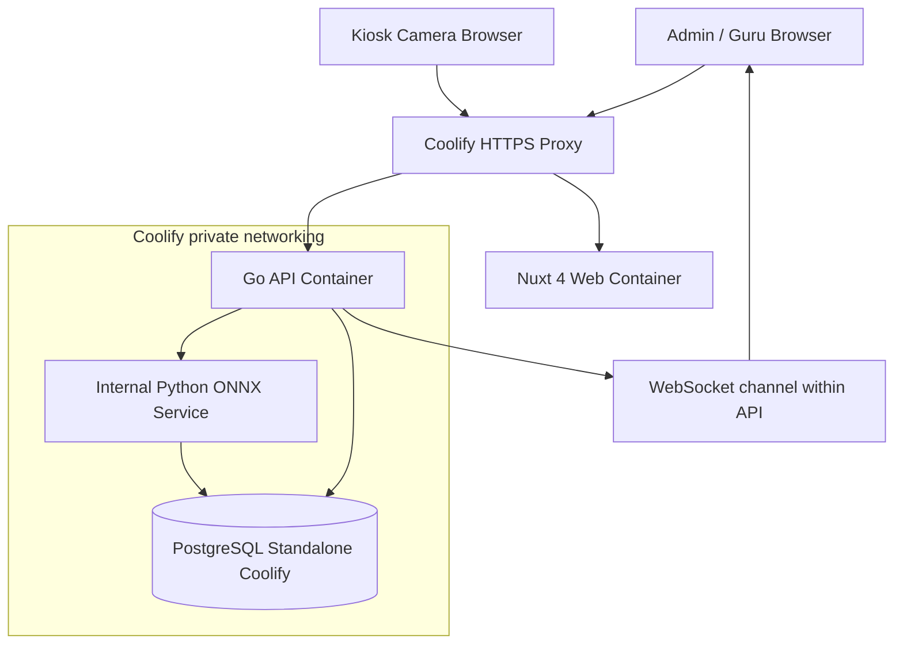
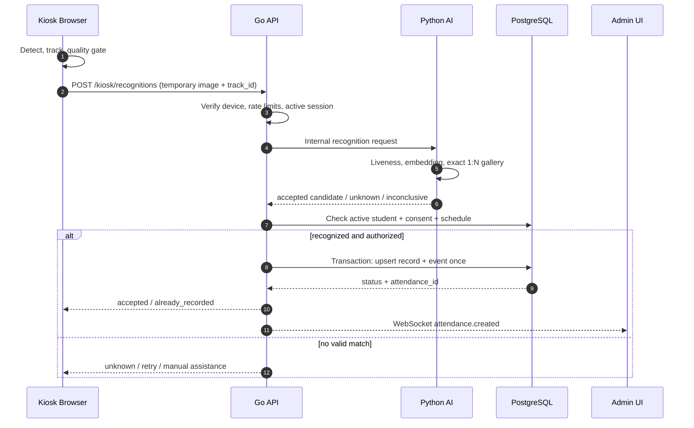
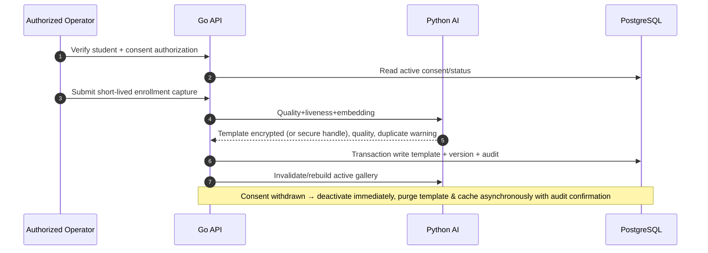
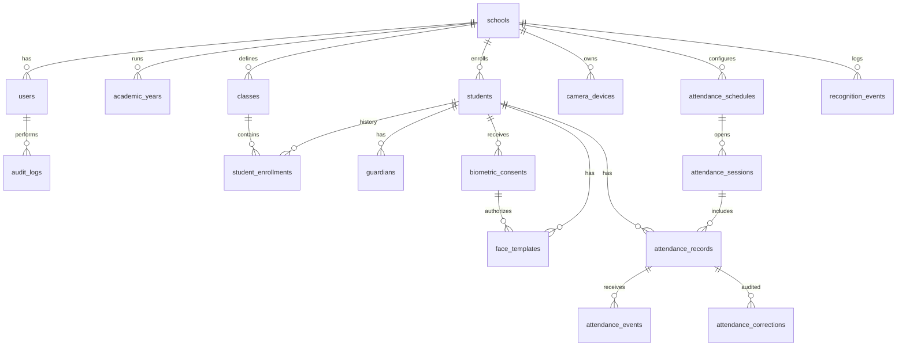

# SCHOOL FACE ATTENDANCE — BLUEPRINT LENGKAP

Versi 1.0 • 12 Oktober 2026. Sumber modular tersedia pada berkas terpisah dalam ZIP. Dokumen ini rancangan, belum aplikasi operasional.

---

# 01 — Product Requirements Document (PRD)

## Metadata

- **Produk:** School Face Attendance
- **Versi dokumen:** 1.0 (12 Oktober 2026)
- **Platform:** Responsive Web Admin, kiosk web kamera
- **Target:** Satu sekolah (MVP), arsitektur dapat diperluas
- **Status:** Draft untuk engineering/legal/design review

## 1. Masalah dan nilai

Absensi manual memerlukan waktu, mudah terjadi keterlambatan rekap, dan berisiko input ganda. Produk menawarkan pencatatan real-time dan laporan terpusat. Karena pemrosesan biometrik anak berisiko tinggi, **sistem tidak boleh bergantung secara eksklusif pada AI**: sediakan jalur manual yang setara dan audit koreksi.

## 2. Tujuan bisnis & non-tujuan

**Goals:** (G-1) absensi masuk otomatis tanpa input identitas; (G-2) satu sumber kebenaran data siswa/kelas; (G-3) laporan yang dapat diaudit; (G-4) meminimalkan salah identifikasi, duplikasi, retensi berlebihan; (G-5) operasi kiosk sederhana.

**Non-goals MVP:** monitoring CCTV umum, pelacakan lokasi siswa, analisis emosi/demografi, pengenalan di ruang publik, penilaian disiplin otomatis dari AI, multi-sekolah SaaS, mobile app native, integrasi pembayaran, WhatsApp mass messaging, model AI dilatih dari biometrik sekolah, pencarian visual bebas oleh guru.

## 3. Persona & akses

| Persona | Tugas | Akses |
|---|---|---|
| Super Admin Sekolah | pengguna, konfigurasi, audit, pengelolaan siswa | Scope satu sekolah |
| Admin Tata Usaha | CRUD siswa/kelas, import, absensi, laporan | Sesuai izin RBAC |
| Operator Kiosk | registrasi dengan izin, kesehatan perangkat, review kegagalan | Terbatas, biometrik sensitif dibatasi |
| Guru/Wali Kelas | lihat absensi kelas, ajukan koreksi, ekspor terbatas | Hanya kelas/tahun ajar ditugaskan |
| Siswa | datang di area absensi atau memilih jalur alternatif | Tidak perlu akun kiosk |
| Orang Tua/Wali | informasi, persetujuan/penarikan via proses terverifikasi | Tidak wajib portal MVP |

## 4. User journeys utama

### Journey J-1: Data siswa

Admin login → halaman Siswa → tambah / import → validasi NIS unik dalam sekolah → pilih kelas/tahun ajar → simpan → daftar diperbarui. NISN bersifat opsional sesuai data yang diperlukan; tidak perlu menampilkan data berlebihan.

### Journey J-2: Enrollment biometrik

Admin memilih siswa → cek *legal gate* (dasar pemrosesan, pemberitahuan, status persetujuan wali yang sesuai) → capture beberapa sampel → quality & liveness check → cross-check duplikat → petugas review bila ambigu → enkripsi template → aktifkan di gallery → audit. Tolak proses jika consent ditarik atau tidak valid. Jalur manual tetap tersedia.

### Journey J-3: Absensi otomatis 1:N

Kiosk terdaftar aktif → mendeteksi wajah di zona absensi → memilih frame berkualitas → mengirim gambar sementara ke API → AI melakukan liveness dan exact match gallery → keputusan `accepted`, `unknown`, `inconclusive`, atau `spoof_suspected` → Go validasi status siswa/sesi/device/consent → transaksi idempotent → respons kiosk terbatas + event dashboard.

### Journey J-4: Absensi alternatif / koreksi

Operator memilih siswa setelah verifikasi administratif → alasan dan bukti minimum → rekam event manual + siapa, kapan, alasan → bila kebijakan memerlukan, approver berbeda menyetujui → rekap berubah dengan audit, tidak menghapus histori.

### Journey J-5: Laporan

Guru memilih tahun ajar, kelas, tanggal → melihat hadir/terlambat/izin/sakit/alfa (setelah sesi ditutup) → ekspor terbatas dan terlacak.

## 5. Requirement fungsional

| ID | Requirement | Prioritas | Acceptance criteria |
|---|---|---|---|
| FR-01 | Login admin/operator/guru | P0 | Sesi aman, logout dan timeout; akses dicek server |
| FR-02 | CRUD siswa + status | P0 | NIS unik per sekolah; perubahan terekam audit |
| FR-03 | Tahun ajaran, kelas, penempatan | P0 | Sejarah penempatan tidak hilang saat naik kelas |
| FR-04 | Import CSV/XLSX | P1 | Preview dry-run, validasi baris, rollback bila gagal |
| FR-05 | Device provisioning | P0 | Hanya kiosk terdaftar bisa kirim recognition; bisa revoke |
| FR-06 | Consent dan enrollment biometrik | P0 | Tidak bisa aktif tanpa status legal valid; log pemberian/penarikan |
| FR-07 | Recognition otomatis 1:N | P0 | Tidak butuh NIS/QR; unknown tetap unknown |
| FR-08 | Liveness/quality/multi-frame stabil | P0 | Frame buruk dan inconclusive tidak mencatat kehadiran |
| FR-09 | Attendance masuk/pulang | P0/P1 | Check-in P0; check-out P1; jadwal/hari libur dikonfigurasi |
| FR-10 | Anti-duplicate | P0 | Unik per `(school, session, student)` dalam transaksi concurrent |
| FR-11 | Izin/sakit/absen manual & koreksi | P0 | Membutuhkan alasan, otorisasi, dan jejak audit |
| FR-12 | Dashboard dan laporan | P0 | Filter kelas/tanggal/status, ekspor sesuai role |
| FR-13 | Update event real-time | P1 | Admin melihat attendance baru via WebSocket, fallback refetch |
| FR-14 | Audit log | P0 | Terlacak actor/action/target/time tanpa gambar/raw template |
| FR-15 | Lifecycle biometric | P0 | Revoke & purge dari DB, cache, dan backup berdasarkan kebijakan |
| FR-16 | Akses guru berbasis kelas | P0 | Guru tidak bisa membaca siswa kelas lain lewat direct API |
| FR-17 | Kiosk offline behavior | P1 | Fail-closed untuk biometrik, tidak menyimpan raw image di browser |
| FR-18 | Health, model version & metrik | P0 | Operator tahu kamera/AI/service error, tanpa data PII di log |

## 6. Aturan bisnis

- `school_timezone = Asia/Jakarta` secara default; simpan semua timestamp di PostgreSQL sebagai `timestamptz` UTC dan tampilkan zona lokal.
- Kalender sekolah mengatur hari efektif, libur, waktu check-in/out, batas terlambat dan grace period.
- Status awal `not_recorded`; label `absent` baru disahkan setelah sesi ditutup dan reconciliation selesai. Jangan set `alfa` segera setelah kamera gagal.
- Recognition hanya untuk siswa aktif yang terdaftar dan memiliki status legal/consent valid pada saat pengenalan.
- `unknown/inconclusive/spoof` tidak dikaitkan dengan identitas; jangan otomatis menghukum siswa.
- Identitas yang sudah diverifikasi satu kali pada sesi tidak menghasilkan baris absensi baru saat tertangkap kamera kembali.
- Admin tidak boleh mengedit jam masuk yang sudah dicatat tanpa catatan koreksi yang dapat diaudit.
- Hak akses dibatasi `school_id`, `class_id`, `device_id`, dan role.

## 7. Requirement non-fungsional (target pilot, bukan klaim)

| ID | Kategori | Target pengujian |
|---|---|---|
| NFR-01 | Latency | P95 wajah layak → keputusan UI ≤2 detik pada pilot |
| NFR-02 | False identification | Sasaran FPIR ≤0,1% di set uji; tidak diinterpretasi sebagai bukti sebelum sample memadai |
| NFR-03 | Availability | Target operasional yang disepakati sekolah; mode manual saat outage |
| NFR-04 | Performance | Uji 500 siswa, 1-2 kiosk, burst saat jam masuk |
| NFR-05 | Reliability | Tidak ada absensi ganda, uji concurrent dan replay request |
| NFR-06 | Privacy | Tidak menyimpan gambar/video wajah mentah default; retensi ketat |
| NFR-07 | Security | HTTPS, RBAC, secrets, at-rest encryption, audit, endpoint internal |
| NFR-08 | Accessibility | Keyboard navigable, labels, status tak hanya warna, target WCAG 2.2 AA |
| NFR-09 | Maintainability | Modular monolith, migration, lint, test, typed API |
| NFR-10 | Observability | Structured logs tanpa PII, tracing dengan `request_id`, health metrics |

## 8. Data minimal yang perlu dikumpulkan

Siswa: NIS, nama, kelas dan status aktif. Tahun ajar dan class enrollment untuk sejarah; wali hanya informasi yang diperlukan untuk proses consent. NISN, foto profil dan kontak tidak otomatis wajib. Wajah mentah adalah input sementara, **bukan** identitas permanen.

## 9. Kriteria rilis MVP (go/no-go)

- Skenario J-1 sampai J-4 lulus UAT.
- Consent withdrawal benar-benar menghentikan pencocokan dan memicu penghapusan sesuai retention plan.
- Unknown tidak false-accept pada test sesuai target evaluasi; ukuran sampel serta uncertainty dicatat.
- API role/class-level forbidden tests lulus.
- Kiosk tidak expose hasil sensitif di layar publik.
- Duplikasi concurrent dan request replay terblokir.
- DPIA/legal review dan prosedur fallback tersedia sebelum data anak digunakan.

## 10. Keputusan bisnis yang perlu divalidasi sekolah

Jadwal masuk/pulang, kebijakan izin dan sakit, rentang koreksi, pengelola consent, SOP jika sistem tidak mengenali siswa, masa retensi menurut kebutuhan sah, jumlah kamera, konektivitas lokasi kiosk, dan perangkat fisik. Blueprint memberikan default; bukan keputusan sepihak atas kebijakan sekolah.


---

# 02 — System Architecture & Engineering Blueprint

## 1. Prinsip

- **Modular monolith Go + separate AI microservice**, bukan microservices untuk semua fitur.
- Identifikasi otomatis **open-set 1:N** dengan opsi reject; tidak ada input nama/QR.
- Pemrosesan kamera hanya di area yang memang ditetapkan untuk absensi.
- Minimasi data: frame sementara, embeddings disimpan terenkripsi, metadata recognition singkat.
- Fail-safe: jika AI/jaringan/consent invalid → review/manual, **tidak** auto-presence.
- Deployment aplikasi hanya berisi tiga container: `web`, `api`, `ai`; PostgreSQL *standalone resource* Coolify.

## 2. Container context



> Compose contoh mengasumsikan resource berada di satu Docker network privat yang dapat saling resolve. Di Coolify, koneksi lintas resource perlu jaringan/DNS yang secara eksplisit sudah diverifikasi; nama host contoh tidak boleh di-hardcode tanpa pemeriksaan.

## 3. Modul Go

| Modul | Service responsibility |
|---|---|
| `auth` | Sessions, password hashing, policies |
| `school` | Profil & timezone |
| `students` | CRUD, import, status, PII controls |
| `academics` | Academic years, classes, enrollments, teacher assignments |
| `consent` | Legal gate, consent history, withdrawal |
| `biometrics` | Enrollment coordination, lifecycle, gallery invalidation |
| `devices` | Provisioning, rotation/revoke, camera status |
| `attendance` | Sesi, absensi, business rules, idempotency, manual & corrections |
| `reporting` | Aggregates/filter exports |
| `audit` | Security/audit events |
| `realtime` | Event delivery & authorization |

Folder modul menyimpan `handler`, `service`, `repository` dan `model` seperlunya. Jangan membuat layer abstraksi generik tidak terpakai. Transaction scope hanya ada di Go attendance module.

## 4. Sequence — automatic check-in



Key privacy property: Python never returns candidate lists with identity to kiosk; Go accepts only signed/internal results. Capture images are held only in request memory; no body logging or disk temp files by default.

## 5. Sequence — enrollment/revocation



Revocation should deactivate matching synchronously in access control, then purge storage/cache with monitored job. If purge fails, keep biometric route blocked and alert operator.

## 6. Recognition algorithm policy

1. Browser detects/track multiple faces and quality gates size, orientation, blur, illumination.
2. Sample a frame when quality adequate; rate limit per temporary track; do not send all frames.
3. Server validates device identity, active session, time, origin, image type/size, and replay nonce.
4. Python rejects ambiguous/multiple/low-quality inputs and spoof-suspected probes.
5. Model produces normalized embedding; gallery contains only active/authorized identities from this school.
6. Exact cosine similarity scans active templates; evaluate calibrated threshold and separation margin from runner-up.
7. Decision must persist for multiple observations of same track prior to auto-check-in, with TTL.
8. Unknown/inconclusive never gets a name or attendance record automatically.
9. Template version/model ID strictly match; re-enrollment needed if embedding model changes incompatibly.
10. Never present raw similarity score to kiosk or use it as a probability of truth.

## 7. Multi-face / throughput

Tracked faces are handled independently. A single detected frame may contain multiple students, but request budgets and independent stable match decisions apply. Pilot must prove whether this is supported at acceptable throughput; otherwise guide students to one-person capture zone.

Performance experiments: 30 FPS video display ≠ 30 AI inferences/s. Start 3-5 detection checks/s per kiosk and ≤1 recognition request/s per face track, tune with P95 latency, device CPU/RAM, model throughput, frame bandwidth. These are starting settings, not measurements.

## 8. Failure modes

| Failure | Behavior |
|---|---|
| Camera denied | Show remediation; kiosk offline badge; manual attendance |
| AI down / timeout | No auto attendance; backoff; alert operator |
| DB unavailable | No fake success; manual secure procedure; reconciliation |
| Network intermittent | Drop temporary frames; DO NOT cache photos/embedding locally |
| Consent revoked | Immediately exclude from active matching gallery |
| Low light / occlusion | Retry with guidance; switch manual if persistent |
| Duplicate/replay | Server idempotent response `already_recorded` |
| Same student multiple kiosks | Database unique constraint + transactional lock handles race |
| Inaccurate match suspicion | Freeze auto-approval & require manual review |

## 9. Attendance transaction (pseudocode)

```text
BEGIN
  validate active device, school, schedule, student, consent at event time
  INSERT attendance_events(event_id, device_id, ...) ON CONFLICT DO NOTHING
  if event already exists: read current attendance record; return idempotent response
  INSERT attendance_records(session_id, student_id, first_seen_at, status)
    ON CONFLICT (session_id, student_id)
    DO UPDATE only when allowed by explicit check-in/check-out state rules
  INSERT audit_entries ...
COMMIT
publish sanitized attendance.created event AFTER commit
```

Use **transactional outbox** only when delivery guarantees justify it; MVP can use in-process publish plus client refetch/reconciliation. WebSocket is a convenience channel, not the source of truth.

## 10. Repository structure

```text
school-face-attendance/
├── apps/
│   └── web/                        # Nuxt 4
│       ├── app/
│       │   ├── pages/{login,admin,kiosk}/
│       │   ├── components/{ui,layout,students,attendance,camera,reports}/
│       │   ├── composables/
│       │   ├── stores/
│       │   ├── middleware/
│       │   └── assets/css/
│       ├── nuxt.config.ts
│       └── Dockerfile
├── services/
│   ├── api/
│   │   ├── cmd/api/
│   │   ├── internal/{auth,students,academics,biometrics,attendance,devices,reporting,audit}/
│   │   ├── internal/platform/{config,db,http,security,events}/
│   │   ├── migrations/
│   │   ├── go.mod
│   │   └── Dockerfile
│   └── ai/
│       ├── app/{api,engines,recognition,enrollment,security,metrics}/
│       ├── tests/
│       ├── pyproject.toml
│       └── Dockerfile
├── deploy/
│   ├── compose.application.yml
│   └── .env.example
├── docs/
│   ├── prd.md
│   ├── design.md
│   ├── architecture.md
│   └── api.md
├── scripts/
└── README.md
```

## 11. Tech tradeoffs & ADRs

- ADR-001: Nuxt 4 + shadcn-vue for Vue UI; avoid React-only shadcn copy/paste.
- ADR-002: Go monolith owns school data/attendance transactions; avoids distributed saga complexity.
- ADR-003: Python isolated AI runtime; allows replacing model without reworking attendance logic.
- ADR-004: Embedding encryption application-side and exact secure gallery in memory first; avoids exposed queryable biometric database for MVP.
- ADR-005: PostgreSQL standalone managed Coolify; not duplicated within application compose.
- ADR-006: WebSocket is ephemeral event delivery; REST/requery is canonical state.
- ADR-007: No autonomous negative attendance consequences; manual review mandatory.

## 12. Scaling pathway

1 kiosk/500 users → exact in-memory matching and Go transaction. At 5+ kiosks or 10k+ active students, benchmark AI worker pool / GPU and model concurrency. Evaluate partitioned gallery, controlled ANN (pgvector only if extension available in Coolify database), async event buffering with encrypted payload only if requirements demand. Multi-school tenancy requires enforceable tenant policies and an isolation audit before launch.


---

# 03 — UI/UX Design Blueprint — shadcn-vue Dashboard

## 1. Design direction

**Konsep:** modern, bersih, fungsional, profesional, dan tidak terasa seperti sistem CCTV. Design menggunakan visual style **shadcn Dashboard**: sidebar collapsible, top navigation, cards tipis, tabel informasi padat, dropdown/filter, dialog, sheets, toast. Hindari gradient warna-warni dan animasi berlebihan. Berikan informasi yang relevan saja untuk petugas sekolah.

**Platform:** desktop 1440×900 menjadi baseline desain, tablet 1024, mobile 390 (untuk admin ringan); **kiosk full-screen** baseline 1080p landscape. Gunakan font Inter atau Geist Sans (periksa lisensi saat bundling), font mono khusus data numerik. Bahasa utama: Indonesia.

**Implementation:** Nuxt 4 + Tailwind CSS v4 + shadcn-vue (`shadcn-nuxt`), bukan shadcn/ui React. UI primitives di `app/components/ui`, komponen domain di `app/components/<domain>`.

## 2. Design tokens (konseptual)

| Token | Light | Dark |
|---|---|---|
| Background | `#FAFAFA` | `#09090B` |
| Card/Panel | `#FFFFFF` | `#18181B` |
| Primary | `#18181B` | `#FAFAFA` |
| Primary foreground | `#FAFAFA` | `#18181B` |
| Text primary | `#18181B` | `#FAFAFA` |
| Muted | `#71717A` | `#A1A1AA` |
| Border | `#E4E4E7` | `#27272A` |
| Success | `#16A34A` | `#22C55E` |
| Warning | `#CA8A04` | `#EAB308` |
| Danger | `#DC2626` | `#EF4444` |
| Focus ring | `#2563EB` | `#60A5FA` |

Override hanya melalui CSS vars theme, tidak menggunakan warna status sebagai satu-satunya indikator. **Radius**: 8px input, 10–12px cards; **spacing**: skala 4/8/12/16/24/32; **header** ~64px; **sidebar** 256px desktop, compact ~64px. Tabel 44–48px per baris. Gunakan sticky header table dalam viewport panjang.

## 3. Sistem layout

```text
┌─────────────────────────────────────────────────────────────────────────┐
│ [SA] SCHOOL ATTENDANCE  │  Cari siswa...   │  🔔  │ Admin  ▼           │
├─────────────────────────┼───────────────────────────────────────────────┤
│ OVERVIEW                │ Dashboard / Ringkasan                          │
│ ▣ Dashboard             │ Selamat datang, Admin                          │
│ ◎ Live Attendance       │                                               │
│ ▦ Siswa                 │ [Total] [Hadir] [Terlambat] [Belum tercatat]   │
│ ▤ Kelas                 │                                               │
│ ◉ Registrasi Wajah      │ [Grafik 7 hari]      [Distribusi status]       │
│ ◷ Absensi               │                                               │
│ ▦ Jadwal                │ [Riwayat masuk terakhir / DataTable]           │
│ ◫ Laporan               │                                               │
│ ─────────────────────── │                                               │
│ ◉ Kamera & Perangkat    │                                               │
│ ⚙ Pengguna/Pengaturan  │                                               │
└─────────────────────────┴───────────────────────────────────────────────┘
```

Sidebar groups: **Overview**: Dashboard, Live Attendance. **Akademik**: Siswa, Kelas, Tahun Ajaran. **Absensi**: Absensi, Jadwal, Registrasi Wajah, Laporan. **Sistem**: Kamera/Perangkat, Pengguna & Role, Consent, Audit Log, Pengaturan.

## 4. Sitemap dan komponen shadcn-vue

| Route | Tujuan | Komponen utama |
|---|---|---|
| `/login` | Masuk pengguna | Card, Label, Input, Button, Alert |
| `/admin` | KPI + statistik | Sidebar, Breadcrumb, Card, Badge, Chart |
| `/admin/live` | Monitoring real-time | Card, Badge, Tabs, Skeleton, ScrollArea |
| `/admin/students` | CRUD data siswa | DataTable via Table + TanStack, Input, Select, DropdownMenu, Pagination |
| `/admin/students/new` | Form input siswa | Card, Form, Input, Select, Calendar, Button |
| `/admin/students/[id]` | Profil, history, consent, wajah | Tabs, Badge, Alert, Separator, Dialog |
| `/admin/classes` | Kelas/tahun ajaran | Table, Dialog, Combobox |
| `/admin/face-enrollment` | Queue enrollment | Table, Dialog, Alert, Stepper custom |
| `/admin/attendance` | Rekap dan koreksi | Table, Date picker, Sheet, Dialog, Badge |
| `/admin/schedules` | Jam masuk/pulang dan kalender | Card, Form, Calendar, Dialog |
| `/admin/reports` | Laporan rekap/ekspor | Chart, Card, Table, DropdownMenu |
| `/admin/devices` | Kamera terdaftar | Card, Badge, DropdownMenu, AlertDialog |
| `/admin/consents` | Consent & lifecycle | Table, Drawer/Sheet, Alert, destructive Dialog |
| `/admin/audit` | Log audit | Table, Filter, DateRange, Badge |
| `/admin/settings` | Sekolah & pengguna | Tabs, Form, AlertDialog |
| `/kiosk/[deviceId]` | Kamera absensi | Full-screen custom UI; minimum public PII |

## 5. Dashboard: visual specification

**Page header:** title `Dashboard`; subtitle `Ringkasan kehadiran siswa hari ini`; right actions: `Pilih Tanggal` dan `Unduh Laporan` (role-guarded).

**KPI cards row (4):** Total Siswa Aktif, Sudah Hadir, Terlambat, Belum Tercatat. Nilai contoh harus jelas demo. Bedakan `Belum Tercatat` dari `Alfa` (alfa hanya setelah penutupan sesi).

**Chart section:** kiri trend kehadiran 7 hari; kanan persentase status hari ini. Graph read-only memakai komponen `Chart` dari shadcn-vue (berbasis Unovis), sehingga konsisten dengan UI kit; tidak perlu memasang ECharts untuk MVP.

**Last events:** Table dengan waktu, nama singkat, NIS masked, kelas, status, device, sumber. Untuk public board, jangan tampilkan nama lengkap. Dashboard admin terautentikasi boleh menampilkan sesuai scope role.

**State:** loading skeleton, empty new academic year, read error Alert + Retry, stale realtime indicator, filter panel visible.

## 6. Siswa: tabel

Toolbar: search nama/NIS, filter kelas, status aktif, status registrasi wajah; actions: `Import CSV/XLSX`, `Tambah Siswa`.

Columns: checkbox opsional untuk bulk non-destructive, Nama, NIS, Kelas Saat Ini, Status, Status Wajah (`Terdaftar`, `Belum`, `Ditangguhkan`), Updated At, `...` Row actions (`Lihat Detail`, `Edit`, `Daftarkan Wajah`, `Nonaktifkan`). Sorting server-side, pagination 20/50/100, debounced search 300 ms. Bulk delete **tidak** tersedia untuk siswa dengan riwayat aktif; arsip/soft-delete dengan retention.

Form `Tambah Siswa`: NIS required, nama required, kelas optional sebelum penempatan, status active default. NISN, tanggal lahir, nomor wali opsional berdasarkan kebijakan minimisasi data. Inline field error, toasts untuk sukses, field dirty-protection saat pindah halaman.

Student detail tabs: `Profil`, `Riwayat Kelas`, `Absensi`, `Consent & Biometrik`, `Audit`. Profil tidak menampilkan embedding atau raw sample. Consent accessible only authorized users.

## 7. Registrasi Wajah: wizard 5 langkah

1. Pilih siswa & pastikan active status.
2. Verifikasi dasar pemrosesan dan persetujuan wali yang sesuai; jika belum, tampilkan link prosedur nonbiometrik.
3. Aktifkan kamera sementara setelah tindakan operator; tunjukkan petunjuk pencahayaan, area wajah, privacy notice.
4. Ambil sampel dengan quality checks, liveness, dedup candidate (review private), status Processing/Success/Error.
5. Ringkasan versi model, kualitas, audit, status template. **Tidak menampilkan face embedding.**

Camera element di wizard harus di-unmount saat dialog ditutup, page hidden atau proses selesai; stop semua media tracks. Kegagalan consent adalah *hard block*.

## 8. Kiosk: desain khusus berbeda dari admin

- Full-screen video preview + face boxes dengan guidance minimal (kamera aktif/nonaktif, berdiri di area, bergerak lebih dekat).
- Hasil sukses berupa icon + `Absensi berhasil` + waktu. Identitas publik maksimal inisial/nama depan apabila benar-benar diperlukan; default tanpa nama.
- `Sudah tercatat` muncul beberapa detik tanpa menambahkan record lagi.
- `Tidak dikenali`, `Kualitas kurang`, `Verifikasi perlu petugas`, `Kamera tidak aktif`, `Server terputus` harus jelas dan non-stigmatising.
- Kiosk tidak menampilkan confidence, galeri orang, metadata model, log request atau daftar siswa.
- Akses konfigurasi kiosk terkunci ke operator; fullscreen bukan mekanisme keamanan.

## 9. Figma-ready UI patterns

- Button: Primary, Secondary, Outline, Ghost, Destructive. Pakai icon + text pada action penting.
- Badge: `Hadir` green, `Terlambat` amber, `Izin` blue, `Sakit` neutral, `Alfa` red, `Belum Tercatat` outline. Jangan bergantung warna.
- Dialog: confirmation untuk non-destructive; `AlertDialog` khusus tindakan destruktif, revoke biometrik.
- DataTable: server pagination/sort, row actions dropdown, export only on roles with permission.
- Feedback: Toast untuk success, Alert untuk blocking, Skeleton saat fetch, no flickering metrics.
- Layout: `SidebarProvider` → `AppSidebar` → `SidebarInset` → header dan content; `SidebarTrigger` di header.
- Empty states berikan CTA (`Tambah Siswa`, `Atur Jadwal`) sesuai izin.
- Form menggunakan labels semantik, Zod schema validation, tidak menampilkan data pribadi berlebihan.

## 10. Implementasi setup shadcn-vue

```bash
pnpm create nuxt@latest apps/web
cd apps/web
pnpm add tailwindcss @tailwindcss/vite
pnpm dlx nuxi@latest module add shadcn-nuxt
pnpm dlx shadcn-vue@latest init
pnpm dlx shadcn-vue@latest add sidebar button card badge input table tabs dialog alert-dialog dropdown-menu select sheet skeleton separator tooltip breadcrumb form calendar
```

Tambahkan `@tailwindcss/vite` pada `nuxt.config.ts`, CSS `@import "tailwindcss";`, dan `shadcn-nuxt` modules sesuai dokumentasi terkini. Komponen chart bila diperlukan: `pnpm dlx shadcn-vue@latest add chart` (verifikasi kompatibilitas dan Unovis). `@tanstack/vue-table` untuk data table server-side; jangan memaksakan sorting client untuk data besar.

Contoh layout tingkat tinggi (**pseudocode Vue**) :

```vue
<template>
  <SidebarProvider>
    <AppSidebar />
    <SidebarInset>
      <header class="flex h-16 items-center gap-2 border-b px-6">
        <SidebarTrigger />
        <Breadcrumb />
        <div class="ml-auto"><UserMenu /></div>
      </header>
      <main class="p-4 md:p-6"><slot /></main>
    </SidebarInset>
  </SidebarProvider>
</template>
```

`AppSidebar`, `UserMenu` adalah komponen domain yang harus dibuat. `Breadcrumb` perlu children sesuai kontrak komponen. Ini blueprint, bukan file yang langsung dapat dikompilasi.

## 11. Responsive / accessibility / states

- Desktop: sidebar full, KPI 4 kolom, charts 2 kolom, table horizontal scroll bila diperlukan.
- Tablet: sidebar collapsible, KPI 2 kolom, chart stacked.
- Mobile admin: sheet sidebar, KPI 1 kolom, DataTable disederhanakan ke row cards atau horizontal scroll yang bisa diakses.
- Touch targets ≥44×44 px untuk kiosk. Fokus jelas, trap focus di Dialog, status announce ke screen reader, tidak mengandalkan animasi.
- Dark mode optional, default light untuk lingkungan sekolah; semua token harus uji kontras WCAG.

## 12. Design handoff & QA

Deliverables desain: sitemap, token sheet, 16 route specs, desktop/tablet/mobile breakpoints, state matrix (loading/empty/success/error/forbidden/offline), design-to-code mapping shadcn-vue, dan copy Bahasa Indonesia. Reviewer memeriksa konsistensi spacing, icon, ketinggian form, overflow data table, permission states, keyboard flows, *privacy by design*, serta responsif.

## 13. Preview visual

Buka `admin-dashboard-preview.html` untuk konsep interaktif **statis** (data demo). Implementasi produksi harus dibuat ulang dengan Nuxt + shadcn-vue components dan API sungguhan.


---

# 04 — Database & Data Dictionary

## 1. Penyimpanan

PostgreSQL pada **Database Service resource Coolify**, tidak ada DB dalam compose app. Raw video dan gambar wajah **tidak** disimpan default. Template embedding disimpan **sebagai ciphertext terenkripsi oleh aplikasi** (`bytea`), dengan key di luar DB. Untuk gallery kecil, AI memuat template valid ke memory secara terkontrol untuk matching; tidak ada `pgvector` dalam migration dasar.

## 2. ERD inti



## 3. Core data dictionary

| Tabel | Kolom utama | Constraint / catatan |
|---|---|---|
| `schools` | id, name, timezone, is_active | satu sekolah MVP |
| `users` | id, school_id, email, password_hash, role, is_active | unique email per sekolah, hash Argon2id |
| `academic_years` | school_id, name, starts_on, ends_on | non-overlap via app rules |
| `classes` | school_id, code, name, level | unique code per school |
| `students` | school_id, nis, nisn(nullable), full_name, status | unique `(school_id, nis)` |
| `student_enrollments` | student_id, class_id, academic_year_id, joined_at, left_at | unique within year per student (MVP) |
| `guardians` | student_id, name, contact_encrypted (nullable), relationship | minimal data; mask display |
| `biometric_consents` | student_id, guardian_id, status, signed_at, withdrawn_at, notice_version, evidence_ref | immutable history; evidence safeguarded |
| `face_templates` | student_id, consent_id, model_version, dimension, ciphertext, nonce, key_version, status | encrypted, no plain embeddings |
| `camera_devices` | school_id, device_code, status, last_seen_at, secret_hash | no secrets in clear |
| `attendance_schedules` | school_id, name, checkin_start, checkin_cutoff, close_time, timezone | times defined in local zone |
| `attendance_sessions` | schedule_id, session_date, opens_at, closes_at, status | unique schedule/date, UTC timestamps |
| `attendance_records` | session_id, student_id, status, check_in_at, check_out_at, source | unique session/student |
| `attendance_events` | attendance_record_id, event_uuid, event_type, device_id, event_at | append-only, unique event UUID |
| `recognition_events` | school_id, device_id, decision, matched_student_id nullable, model_version, created_at | short retention, no face crop |
| `attendance_corrections` | record_id, requested_by, approved_by, reason, previous/new values | no silent rewriting |
| `audit_logs` | school_id, actor_id, action, target_type, target_id, occurred_at, metadata | metadata redacted |

## 4. Status enums (stored as CHECK constraints in base SQL)

- Student: `active`, `inactive`, `graduated`, `transferred`.
- Consent: `granted`, `withdrawn`, `expired`, `denied`.
- Template: `active`, `suspended`, `revoked`.
- Attendance session: `scheduled`, `open`, `closed`, `cancelled`.
- Attendance record: `present`, `late`, `excused`, `sick`, `absent`, `pending_review`.
- Event type: `check_in`, `check_out`, `manual_adjustment`.
- Recognition decision: `accepted`, `unknown`, `inconclusive`, `spoof_suspected`, `rejected`.

## 5. Attendance transaction

- Backend derives all identity from AI **internal** result, not from external client claim.
- Insert recognition request id with bounded TTL / replay protection. Use DB unique constraint for events.
- A student/session row is unique; duplicate check-in yields `already_recorded`. Check-out may update same summary row while adding new event.
- Any permission/consent/school/session mismatch must abort transaction.
- Reports query attendance records with class join through academic_year placement; filter assigned teacher server-side.
- No absence auto-generation until session is closed & reconciliation complete.

## 6. Indexing & multi-school readiness

Index FKs and common query patterns: `(school_id, nis)`, `(school_id, status)`, `(session_id, student_id)`, `(student_id, recorded_at)`, `(device_id, created_at)`. Database tenant isolation via school-level query guard, optional PostgreSQL Row Level Security after a threat model review. All future multi-school queries must have school scope.

## 7. Data lifecycle

- Enrolment rejected: no template created.
- Consent withdrawn: disable match immediately; purge ciphertext and in-memory gallery; record non-sensitive evidence of deletion.
- Student graduated/transferred: suspend template and delete according to policy; attendance records retained only as legally needed.
- Raw image: discarded after inference, no logs or backups.
- Unknown recognition metadata: retention short, e.g. 1–7 days policy-defined; no identity linking.
- Attendance data: school retention schedule + legal review; example duration not pre-imposed.
- Backup encryption, restoration and deletion from backup lifecycle must be documented before launch.

## 8. SQL file limitations

`schema.sql` berisi baseline relations, constraints, dan index; tidak menyediakan seluruh prosedur akses RBAC, key management, trigger historis, migration rollback, atau materialized aggregate. Untuk produksi gunakan versioned migrations + review penegakan cross-school foreign keys dan integritas audit.


---

# 05 — HTTP & Realtime API Contract (Draft)

## 1. Conventions

Base path `/api/v1`; JSON except transient image upload `multipart/form-data`. All timestamps UTC RFC 3339; response includes `request_id`. User auth: server-side session cookie (`HttpOnly`, `Secure`, `SameSite=Lax/Strict`) with CSRF protection for state changes; RBAC checks on every endpoint. Kiosk access uses short-lived provisioned device session and operational policy (network/device restriction); **browser localStorage tokens are not hardware-secure credentials**. Python API is internal service-to-service only.

Pagination query: `page=1&page_size=20`, maximum 100; sorting allowlisted. Standard error:

```json
{
  "error": { "code": "VALIDATION_ERROR", "message": "NIS sudah digunakan", "fields": {"nis": "duplicate"} },
  "request_id": "a01152ee-034f-4aee-8e5a-9c008d8f9787"
}
```

## 2. Route matrix

| Method | Endpoint | Role | Purpose |
|---|---|---|---|
| POST | `/auth/login` | Public admin login | Create session |
| POST | `/auth/logout` | All logged-in | End session |
| GET | `/auth/me` | All logged-in | Session/role/scopes |
| GET | `/dashboard/summary?date=` | Admin, teacher scoped | KPIs |
| GET | `/students` | Admin, teacher scoped | Search / pagination |
| POST | `/students` | Admin | Add student |
| GET | `/students/{id}` | Admin, teacher scoped | Detail |
| PATCH | `/students/{id}` | Admin | Update |
| POST | `/students/imports/dry-run` | Admin | Validate file |
| POST | `/students/imports/{id}/commit` | Admin | Commit validated import |
| GET/POST | `/classes` | Scoped | Classes |
| GET/POST | `/academic-years` | Scoped | Academic years |
| GET | `/students/{id}/consents` | Authorized admin | Consent history |
| POST | `/students/{id}/consents` | Consent officer | Register validated legal status |
| POST | `/students/{id}/consents/withdraw` | Authorized workflow | Disable matching + queue deletion |
| POST | `/students/{id}/enrollments` | Enroll operator | Start enrollment (transient upload) |
| GET | `/students/{id}/face-status` | Admin/authorized operator | Status only |
| POST | `/kiosk/session` | Provisioned kiosk | Short-lived limited session |
| POST | `/kiosk/recognitions` | Kiosk session | Recognition of cropped temporary image |
| GET | `/attendance-sessions` | Admin/teacher scoped | Schedule sessions |
| GET | `/attendances` | Admin/teacher scoped | Records |
| POST | `/attendances/manual` | Authorized operator | Manually register attendance |
| POST | `/attendance-corrections` | Authorized user | Request correction |
| POST | `/attendance-corrections/{id}/decision` | Approver | Approve/reject |
| GET | `/devices` | Admin/operator | List devices |
| POST | `/devices` | Admin | Provision |
| POST | `/devices/{id}/revoke` | Admin | Revoke instantly |
| GET | `/reports/attendance` | Admin/teacher scoped | Report download/filter |
| GET | `/audit-logs` | Super admin only | Redacted audit trail |
| GET | `/ws/attendance` | Authorized admin/teacher | Realtime events |

## 3. Core payloads

### POST `/students`

```json
{
  "nis": "10245",
  "full_name": "Contoh Siswa",
  "status": "active",
  "class_id": "15b804f7-c8dd-418b-93c9-8169d729d088",
  "academic_year_id": "244d1a7a-cf34-4eec-ae71-9ae118a0f846"
}
```

Returns `201 Created` with generated UUID and enrollment, never face template.

### POST `/kiosk/recognitions` (multipart)

Fields: `image` temporary JPEG/WebP (size/dimension limit), `track_id`, `captured_at`, `event_id`, `session_id`. Device identity is taken from server-authenticated kiosk context, not a free-text `device_id` field. Replay protection uses bounded event UUID/nonce and TTL. Server strips EXIF and drops image bytes after inference; no CDN, S3 or body logging.

```json
{
  "request_id": "af8e7ad0-6789-439c-b574-6a4f6dff21b1",
  "decision": "accepted",
  "attendance": {
    "status": "present",
    "recorded_at": "2026-10-11T23:48:10Z",
    "already_recorded": false
  },
  "ui_message": "Absensi berhasil"
}
```

Unknown response (no candidate):

```json
{
  "decision": "unknown",
  "attendance": null,
  "ui_message": "Belum dapat dikenali. Silakan hubungi petugas."
}
```

No `student_id`, name, face embedding, or similarity score returned to **public kiosk**. Admin dashboard obtains authorized student details through its own session.

### POST `/attendances/manual`

```json
{
  "session_id": "d6739898-7919-4374-8bf5-7b574a461e13",
  "student_id": "32bd8a47-3d8f-47de-bc4f-5b0a39b7f857",
  "status": "present",
  "reason": "Verifikasi petugas saat kamera tidak tersedia"
}
```

The backend records actor and time; never trusts supplied `approved_by` or `created_at`.

## 4. AI internal contract

Internal `POST /internal/v1/recognize` accepts sanitized binary image, school scope, model version, and request ID from Go only. Example result:

```json
{
  "decision": "accepted",
  "candidate_student_id": "32bd8a47-3d8f-47de-bc4f-5b0a39b7f857",
  "model_version": "face-embed-v1",
  "liveness_result": "live",
  "quality_result": "pass",
  "stable_match": true,
  "latency_ms": 326
}
```

Python service is isolated from public internet; Go verifies all business conditions independently. Sensitive quality scores limited to internal testing with redaction.

## 5. WebSocket event

Channel: `/api/v1/ws/attendance`. Authentication via same authorized user session (validate origin) or short-lived WS auth token. Example:

```json
{
  "type": "attendance.created",
  "event_id": "8b11cfa9-2d5e-4cdf-ad15-e7f4b2d9a8ac",
  "school_id": "28d2c384-cd62-4822-9e79-1c2186a70fd0",
  "class_id": "15b804f7-c8dd-418b-93c9-8169d729d088",
  "attendance_id": "df5d21b2-4e86-44fe-b216-7ae50424ea8a",
  "status": "present",
  "occurred_at": "2026-10-11T23:48:10Z"
}
```

Publish only authorized school/class events. No raw biometric data via WebSocket. Reconnect means `GET /attendances?updated_since=...`, because events are not guaranteed durable.

## 6. Error mapping

- `400 VALIDATION_ERROR`: invalid field or frame.
- `401 UNAUTHENTICATED`: no valid session.
- `403 FORBIDDEN`: school/class/role mismatch.
- `404 NOT_FOUND`: resource not visible within scope.
- `409 CONFLICT`: duplicate NIS, concurrent state conflict.
- `410 CONSENT_WITHDRAWN`: not allowed to capture biometrics.
- `413 PAYLOAD_TOO_LARGE`: image limit.
- `422 FACE_QUALITY_LOW` / `SPOOF_SUSPECTED`: no auto-attendance.
- `429 RATE_LIMITED`: request budget exceeded.
- `503 AI_UNAVAILABLE`: fallback to manual.

## 7. Server protection

Allowlist origins and content types; rate-limit login, import and recognition; signed short-lived kiosk sessions; secure headers; bounded JSON/media; audit security changes; no sensitive data in URL query; protect exports with permission + logging; field-level response filtering. Use JSON schema/OpenAPI generation from handlers after implementation; this document is a specification draft, not a generated OpenAPI schema.


---

# 06 — Security, Privacy, Legal & Biometric Safety

> Rancangan teknis, bukan pendapat hukum. Konsultasikan dengan penanggung jawab PDP/hukum sekolah sebelum pilot biometrik siswa.

## 1. Kepatuhan dan tata kelola

UU No. 27 Tahun 2022 menempatkan **data biometrik dan data anak sebagai data pribadi spesifik**. Pemrosesan data anak memerlukan kontrol persetujuan orang tua/wali; pemrosesan berisiko tinggi memerlukan penilaian dampak perlindungan data. Dasar pemrosesan dan kebebasan persetujuan dalam konteks relasi sekolah-anak perlu dianalisis secara khusus; jangan menganggap checkbox sudah cukup. Portal hukum primer: https://peraturan.bpk.go.id/Details/229798/uu-no-27-tahun-2022.

**Dokumen governance wajib sebelum uji dengan anak:** data flow inventory; tujuan spesifik pemrosesan; notifikasi; legal basis; kebijakan consent dan withdrawal; Data Protection Impact Assessment (DPIA); pembagian peran pengendali/prosesor; data processing agreement jika ada vendor; kebijakan retensi; prosedur subject rights; incident response; SOP koreksi dan jalur nonbiometrik.

**Alternatif setara:** kartu administratif yang diverifikasi petugas atau absensi manual tanpa biometrik. Siswa tidak boleh mendapat perlakuan negatif hanya karena menolak biometrik atau AI tidak mengenali wajah.

## 2. Threat model STRIDE ringkas

| Threat | Potensi penyalahgunaan | Mitigasi |
|---|---|---|
| Spoofing | Foto/video dipakai sebagai wajah | Liveness + quality + multi-frame + manual review |
| Tampering | Manipulasi hasil kamera atau request | TLS, device session, replay nonce, rate limits, server decision |
| Repudiation | Admin menyangkal koreksi | Audit immutable-ish, reason, actor, timestamps, approver |
| Information disclosure | Bocor gambar/embedding/identitas | No image retention, app-side encryption, least privilege, no public gallery |
| DoS | Burst upload frame / AI overload | Payload caps, queue backpressure, per-device quotas, timeouts |
| Privilege escalation | Guru baca seluruh biometrik | Server-side RBAC/class scope + sensitive operations segregation |
| Model poisoning | Enrollment salah identitas | Authorized capture, dedup review, enrollment audit, quality gate |
| Model license breach | Pakai pretrained model riset di produk berbayar | License checklist, model manifest, signed model artifacts |

**Liveness tidak 100% anti-spoofing.** Camera RGB saja mungkin tidak cukup untuk ancaman tingkat tinggi. Evaluasi hardware camera/liveness tambahan bila risk assessment menuntut.

## 3. Lifecycle biometrik

```mermaid
flowchart LR
  Notice[Pemberitahuan & dasar pemrosesan] --> Consent[Persetujuan wali / legal gate]
  Consent --> Enroll[Capture sementara]
  Enroll --> Encrypt[Embedding encrypted]
  Encrypt --> Match[Matching in secure memory]
  Match --> Revoke[Penarikan / masa akhir]
  Revoke --> Disable[Stop matching segera]
  Disable --> Purge[Purging DB cache + backup lifecycle]
  Purge --> Audit[Deletion evidence tanpa biometric payload]
```



- Jangan unggah/menyimpan rekaman kamera jangka panjang.
- Enkripsi *template* dengan AES-256-GCM per-record nonces; keys di secret manager/secure KMS, **di luar DB**.
- Pisahkan AI process dan database account. Secret rotation versi, decrypt only in protected process, clear on worker shutdown, caches with bounded TTL.
- Model-generated embeddings adalah biometrik; treat sama sensitifnya dengan gambar.
- Raw image tidak masuk structured logs, traces, crash reports, backups, media analytics.
- Audit consent withdrawal and successful purge; rollback feature must not re-enable revoked identities.

## 4. RBAC Matrix

| Feature | Super Admin | Admin | Teacher | Operator |
|---|:---:|:---:|:---:|:---:|
| Manage student data | Yes | Yes | View class | Limited |
| Register/revoke face | Scoped | With explicit grant | No | Enrollment only |
| Manage consent evidence | Yes | Scoped officer | No | Read eligibility only |
| View absences | All school | All school | Assigned classes | Assigned session |
| Manual attendance | Yes | Yes | Request | With permission |
| Approve correction | Yes | Designated approver | No | No |
| Manage camera devices | Yes | Yes | No | Health only |
| View audit security log | Yes | Limited | No | No |
| Export PII | Controlled | Controlled | Assigned class | No |

Auth details: Argon2id passwords, session rotation, rate limiting, optional TOTP/MFA for admins, cookies HttpOnly Secure SameSite and CSRF validation. User permission must be checked inside Go service and repository queries, never solely via UI.

## 5. Browser/kiosk security

- HTTPS required to access camera via `getUserMedia()` on non-local origins.
- Device browser is semi-trusted; **do not embed static API secrets in JavaScript**. Use short-lived, limited device session provisioned via operator authorization and restricted device/network controls. Kiosk session compromise must be revocable.
- Content Security Policy, restricted API CORS, dependencies pinned & scanned, strong upload size caps.
- End video tracks when enrollment completes/closes; distinguish `camera active` status visually.
- No frame upload outside scheduled purpose, no photos saved in localStorage/service worker caches.
- Public display does not show full name, NISN, DOB, contact, embedding scores or unknown face gallery.

## 6. Services and infrastructure

- Only Nuxt/Go API reachable via managed Coolify ingress; Python AI internal, PostgreSQL private. Block unnecessary host ports via firewall.
- Database credentials stored as Coolify secrets, scoped to principle of least privilege. Enable encrypted backups, test restores, consider WAL recovery requirements.
- Vulnerability scanner for images/packages, pinned base versions, CI secret detection, signed dependencies/models where possible.
- Logs: request IDs, error codes and durations only; redact PII, tokens, cookies, request bodies, image data, embeddings.
- Health checks on services without revealing application secrets. Resource limits for AI to avoid VPS exhaustion.
- Beware Coolify DB resource **runs in its own container behind the service abstraction**; requirement fulfilled by not bundling DB in app compose.

## 7. Audit, retention, incidents

**Audit:** user login/logout, student CRUD, enrollment, consent state change, admin override, export download, device revoke, model version update. No biometric material in audit rows. Restrict audit edits; export logs to tamper-resistant storage if regulation or risk requires.

**Retention:** defined by school policy and law. Default shortest practicable for recognition metadata; consent evidence may need longer retention than template; backups need deletion lifecycle. Do not hardcode years without legal basis.

**Incident response:** block compromised kiosk/session, revoke token, isolate AI, assess breach, preserve sanitized audit records, activate manual process, notify relevant stakeholders/regulator if applicable, rotate secrets, restore from verified backups.

## 8. AI evaluation before launch

Use consented adult volunteers or licensed data first; then limited student pilot only after approvals. Split enrollment vs evaluation samples, include unknown users and environmental conditions. Track 1:N **FPIR** and **FNIR**, P95 latency, spoof attack pass rate (APCER/BPCER where appropriate), subgroup performance where lawful/ethical and sample sufficient. No unqualified accuracy marketing claim. Threshold, model checksum and evaluation record must be versioned. Document false accept / false reject resolution workflow.

## 9. Mandatory go/no-go checks

1. DPIA and legal review approved, alternative attendance live.
2. No raw images retained beyond ephemeral inference without separate lawful purpose.
3. Template encryption, key rotation, and withdrawal/purge tested.
4. AI model license suitable for intended deployment; InsightFace public pretrained models should **not** be assumed commercially licensed.
5. Threat tests: replay/spoof/burst, permission bypass, tenant/class leak, duplicate race.
6. No negative student outcomes from uncertain recognition without a human review.


---

# 07 — Delivery Plan, QA, Acceptance & Handoff

## 1. Development approach

**Two gates**: R&D proof-of-concept first, then controlled MVP build. This avoids building a polished admin panel around an inaccurate or unlawful biometric workflow. Exact duration depends on team size, access to devices/test volunteers and legal approvals; schedule below is illustrative.

| Phase | Work package | Dependencies | Exit criteria |
|---|---|---|---|
| P0 (week 1) | Workshops, data map, DPIA initiation, workflow acceptance | School stakeholders | Signed MVP boundaries + legal gate plan |
| P1 (weeks 2–3) | Nuxt+shadcn-vue shell, Go login, school, siswa, kelas, session DB | P0 | CRUD, RBAC, migration and role tests |
| P2 (weeks 3–4) | Kiosk face detector/tracking + internal AI PoC | Camera access, model license | Demo against consented adults, baseline metrics |
| P3 (weeks 5–6) | Consent, enrollment, templates encryption, 1:N matching, anti-duplicate | P1, P2 | Enrollment lifecycle and attendance working |
| P4 (week 7) | Dashboard/filters, reports, manual override, device management | P3 | Teacher/admin UAT, audit log |
| P5 (weeks 8–9) | Performance/security testing, backups, Coolify deployment, incident playbook | P4 | Pass go/no-go, optional limited pilot |

> Jangan mulai pilot data biometrik siswa hanya berdasarkan estimasi minggu. Legal, consent, safety, model license dan evaluasi harus selesai dahulu.

## 2. Backlog per epic

- **E1 Foundation:** repo structure, CI lint/testing/security scan, DB migration runner, env secret strategy, logging/tracing, health probes.
- **E2 Admin:** login, admin shell, users/roles, students CRUD, class/year CRUD, import dry-run+commit.
- **E3 Biometrics:** legal gate, guardian workflow, capture, model version manifest, template encryption, revoke/purge, gallery rebuild.
- **E4 Kiosk:** kiosk provisioning, media device permissions, browser tracking quality, temporary frame upload, accessibility.
- **E5 Recognition:** stable 1:N exact match, liveness, decision policy, unknown, spoof reject, model calibration.
- **E6 Attendance:** session scheduler, check-in, late, optional checkout, idempotent transaction, manual fallback, corrections.
- **E7 Reporting:** dashboard, list/filters, role-based exports, realtime event reconnection.
- **E8 Delivery:** Docker, Coolify networking, secret management, DB backup restore, security QA, disaster recovery docs.

## 3. Test plan

| ID | Test | Expected |
|---|---|---|
| T-01 | Add student with duplicate NIS same school | 409, clear validation |
| T-02 | Student changes class next year | Historical attendance still tied correctly |
| T-03 | Teacher fetches other class | 403/404, no data leak |
| T-04 | Enroll without valid consent | Hard reject, no template persisted |
| T-05 | Withdraw consent with cached gallery | Immediately block; purge verified |
| T-06 | Unknown adult visits camera | No automatic student attendance |
| T-07 | Printed photo / replayed screen | Reject/flag within tested threat model |
| T-08 | Face low quality | Retry or manual, never auto-pass |
| T-09 | Student passes multiple times | 1 attendance record per session |
| T-10 | Two kiosks same student concurrent | Transaction unique, no duplicate |
| T-11 | Unregistered kiosk spoof request | 401/403/429 |
| T-12 | AI unavailable or DB outage | No false success; manual SOP |
| T-13 | Lost WebSocket connectivity | Reconnect + GET reconciles state |
| T-14 | Export attempted by unauthorized role | Denied and audited |
| T-15 | Restore encrypted backup | System recovers; deleted templates handled by purge lifecycle |
| T-16 | Login XSS, CSRF, session fixation | Blocked by defense controls |
| T-17 | Kiosk browser lost camera permissions | Usable error and fallback |
| T-18 | Model version changed | Reject incompatible embeddings until re-enrollment |
| T-19 | Browser mobile admin/tablet | No critical layout overflow, keyboard accessible |
| T-20 | Day boundary and school holiday | Correct timezone, no phantom absence |

## 4. Performance and AI metrics

- Capture target: P95 ≤ 2 seconds from quality-ready face to UI decision in agreed pilot context. Report P50/P95/P99, cold start, device CPU/GPU/RAM, per-step latency.
- 1:N detection error: **FPIR** (wrong identification of unknown), **FNIR** (missed known person), confusion pair examples, quality-related rejects. Thresholds must be calibrated with separate hold-out evaluation dataset.
- Plan adequate statistical precision: a few hundred attempts alone cannot validate FPIR ≤0.1%; report intervals and sample limitations.
- Concurrency: 1 kiosk initially, then 2 kiosks/peak hallway arrivals; tune browser sending rate and AI worker concurrency empirically.
- Regression: fixed licensed synthetic/adult test dataset with deterministic model checksum, no unauthorized redistribution.

## 5. Quality gates

**Definition of Ready:** role/scope matrix, acceptance examples, legal constraints, API/data contracts, design states and test fixtures agreed.

**Definition of Done:** code reviewed; migrations reviewed; typed schema; unit/integration/e2e tests passing; RBAC tested; no sensitive logs; i18n copy; accessibility; CI security scan; deployment health probes; change log; rollback documented.

**Pilot Go criteria:** DPIA and policy approved, adult R&D satisfactory, model licensing confirmed, alternative attendance works, intrusion and spoof tests pass, backup restore verified, incident plan accessible, staff trained.

## 6. Deliverable handoff

- PRD, UX flow & design tokens, ERD/data dictionary, endpoint contract, threat model, implementation architecture.
- Figma page states or UI code using shadcn-vue; no React components inside Nuxt app.
- Versioned SQL migrations + dummy seed only (no real minors' biometrics in repo).
- Dockerfiles/Compose application, `.env.example`, Coolify setup notes, secure database resource.
- AI model license manifest, validated checksums, threshold calibration report, assessment of bias and operational error.
- UAT results, security scan reports, data retention & deletion jobs, runbooks.

## 7. Next engineering action order

1. Build repo skeleton, signoff of data flows and DPIA plan.
2. Implement `schema.sql` as migration, Go RBAC and attendance service tests.
3. Build UI Dashboard + Students with shadcn-vue and mocked typed API.
4. Implement camera PoC and secure AI inference on **adult consenting testers**, not minors.
5. Add consent/face lifecycle, kiosk and real attendance; evaluate and iterate.


---

# 08 — Hardware, Capacity, SOP & Rollout Operations

## 1. Kiosk hardware baseline untuk pilot (perkiraan, perlu benchmark)

| Component | Baseline pilot | Notes |
|---|---|---|
| Camera | USB UVC 1080p autofocus atau fixed-focus berkualitas | Uji exposure & low light, bukan hanya megapixel |
| Kiosk | Mini PC / laptop dengan browser Chromium up-to-date | MediaPipe berjalan di browser, perlu CPU cukup |
| Display | Monitor 15–24 inci atau tablet berstand | Jelas terlihat tanpa mengekspos identitas siswa |
| Internet/LAN | Ethernet bila memungkinkan | Jaringan stabil, HTTPS; manual fallback offline |
| Lighting | Pencahayaan depan merata, hindari backlight | Hindari posisi tepat menghadap matahari |
| Mounting | Stabil, area satu orang/arah antre | Kamera harus hanya merekam area absensi yang ditetapkan |
| Power | UPS kecil bila diperlukan | Tidak menggantikan prosedur offline |
| AI server | Mulai uji CPU 4 vCPU / 8 GB RAM (indikatif) | Model & workload menentukan; jangan anggap cukup sebelum benchmark |
| Storage | SSD, backup encrypted DB terpisah | Tidak perlu menyimpan raw face/video |

> Kapasitas server bukan rekomendasi pembelian final. Ukur CPU/GPU, concurrency, kamera yang sebenarnya dan model yang sudah berlisensi. AI service boleh butuh lebih banyak resource daripada Go+Nuxt.

## 2. Penempatan fisik kamera

- Zona kamera khusus absensi, tanda pemberitahuan pemrosesan data, operator yang dapat membantu.
- Arah kamera tidak mencakup koridor/ruang kelas di luar zona keperluan absensi.
- Jarak dan tinggi ditentukan hasil percobaan; sediakan petunjuk visual untuk siswa dengan tinggi berbeda.
- Hindari perekaman siswa yang tidak sedang mengikuti absensi; blur/background crop di frontend jika perlu.
- Saat antrian padat, batasi satu orang per capture zone jika multi-face belum terbukti aman.

## 3. Sizing & capacity worksheet

**Input sekolah:** `student_count`, `active_gallery`, `arrival_window_minutes`, `kiosk_count`, `avg_inference_ms`, `retry_rate`, `face_sample_interval`, `network_rtt_ms`.

**Estimasi kebutuhan kecepatan absensi minimum** = `student_count / arrival_window_seconds`. Contoh 500 siswa / 30 menit = 0,278 kehadiran final per detik secara rata-rata; burst nyata jauh lebih besar. Ukur antrean & puncak lebih penting daripada rerata.

**Capacity testing:** 1 kamera → 2 kamera → simulasi burst dan reattempt 10–20%, ambil P50/P95/P99 serta CPU/RAM/dropped request. Tentukan skala AI setelah membandingkan minimal dua kelas model dan license costs.

## 4. SOP harian operator

1. Periksa perangkat online, video permission, sinkronisasi waktu, dan jam sesi.
2. Pastikan alternative attendance (kertas/terminal administratif) tersedia.
3. Buka kiosk pada zona absensi dan monitor status API/AI.
4. Bantu siswa `unknown`, `inconclusive`, atau kesulitan akses, tanpa mengumumkan masalah wajahnya ke publik.
5. Rekonsiliasi absensi dengan guru sebelum menetapkan status alfa setelah sesi tertutup.
6. Laporkan kejadian privacy/security, downtime, atau salah identitas melalui kanal admin.
7. Tutup sesi, review perubahan manual & audit, lakukan backup sesuai jadwal.

## 5. Coolify deployment runbook

1. Deploy PostgreSQL sebagai **standalone Database resource** di Coolify (meski di balik layar berjalan dalam container dikelola Coolify). Buat DB/user akses terbatas.
2. Konfigurasi private network/hostname supaya `api` dan `ai` dapat mengakses DB secara internal; uji resolusi nama antar-resource.
3. Deploy Compose aplikasi: `web`, `api`, `ai` **tanpa DB container**. Simpan secrets di Coolify.
4. Pasang domain **web** misalnya `attendance.example.com` dan domain **API** misalnya `api.attendance.example.com` melalui proxy Coolify, HTTPS untuk keduanya. Konfigurasikan API CORS explicit origin dan secure credential cookies; jangan `*`.
5. Gunakan `NUXT_PUBLIC_API_BASE=https://api.attendance.example.com/api/v1` sebagai contoh. WebSocket memakai `wss://api.attendance.example.com/api/v1/ws/attendance`.
6. Jangan buat domain publik untuk Python AI atau PostgreSQL; expose hanya internal service network.
7. Jalankan migrations yang sudah direview, seed akun admin dengan mekanisme sekali pakai, dan provision kiosk secara terotorisasi.
8. Validasi TLS, kamera browser, health checks, time synchronization, rate limit, e2e check-in, no-duplicate, consent withdrawal.
9. Buat backup encrypted harian/berkala menurut RPO/RTO dan uji restore. Rotate credentials dan review logs.

## 6. Rollback & failure

- Rollback app image hanya ke versi kompatibel migration (backward-compatible migrations / expand-contract).
- Jika pengenalan bermasalah, disable face attendance route melalui feature flag; manual attendance harus terus bekerja.
- Jangan rollback snapshot DB yang menghidupkan kembali consent yang sudah ditarik; replay deletion tombstones/denylist sebelum gallery dibuat ulang.
- Incident severity tinggi (false positive massal, biometrik bocor) → immediate freeze + staff alert + incident plan.

## 7. Operational metrics

`attendance_success_total`, `attendance_duplicate_prevented_total`, `recognition_unknown_total`, `recognition_inconclusive_total`, `recognition_spoof_suspected_total`, `ai_inference_duration_seconds`, `attendance_commit_duration_seconds`, `kiosk_online`, `db_error_rate`, `manual_override_count`, `consent_withdrawal_purge_age`.

Label metrics jangan menggunakan NIS, nama, student UUID, atau per-face identifiers. Hanya aggregate per-device/route/environment sesuai kebutuhan admin keamanan.
