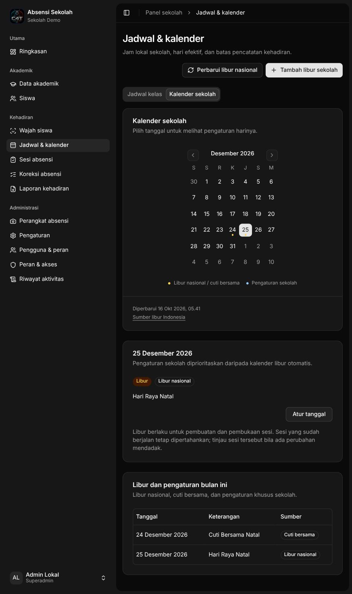

# Kalender sekolah

Buka **Jadwal & kalender → Kalender sekolah**. Kalender mengikuti libur nasional dan cuti bersama dari [Indonesian Holidays API](https://indonesian-holidays.ahrulsyamil.com/docs). Pengaturan khusus sekolah selalu diprioritaskan.

- **Libur semester/kegiatan:** klik **Tambah libur sekolah**, isi tanggal mulai–selesai dan keterangan, lalu simpan. Biarkan **Tetap masuk sekolah** nonaktif untuk libur. Satu pengaturan mencakup maksimal 366 hari.
- **Hari belajar pengganti:** pilih tanggal, klik **Atur tanggal**, aktifkan **Tetap masuk sekolah**, lalu beri keterangan. Ini juga dapat mengubah tanggal libur nasional menjadi hari sekolah.
- **Kembali ke aturan otomatis:** pilih tanggal yang sudah diatur sekolah, lalu klik **Gunakan kalender otomatis**. Pengaturan satu tanggal dilepas; libur nasional/cuti bersama atau hari jadwal kembali berlaku.
- **Pembaruan data:** tombol **Perbarui libur nasional** memperbarui tahun dari bulan yang terlihat. Pembaruan otomatis berjalan setiap hari untuk tahun sekolah berjalan dan tahun berikutnya.

Titik kuning menandai libur nasional/cuti bersama; titik biru menandai pengaturan sekolah. Pilih tanggal untuk melihat jenis hari dan sumbernya. Tanggal biasa mengikuti hari aktif pada jadwal kelas masing-masing.

Libur memengaruhi pembuatan dan pembukaan sesi. Sesi yang sudah berjalan serta riwayat kehadiran tetap dipertahankan. Kalender seluruh sekolah dapat diubah pengelola dengan izin akademik dan cakupan sekolah.

Jika sumber gagal, data terakhir tetap digunakan. Jika suatu tahun belum memiliki data, kalender menampilkan peringatan; sesi otomatis menunggu data atau pengaturan sekolah eksplisit. Pada pemeriksaan 16 Oktober 2026, sumber menyediakan **25 tanggal pada 2026**, sedangkan **2027 masih kosong**. Ini bukan berarti tahun 2027 tidak memiliki hari libur.

## Verifikasi pengembangan

Migrasi 14 dan pembaruan API/web lokal berhasil. `make check`, `make build`, integrasi database auth/masterdata/attendance dengan race detector, dan **15 tes browser** lulus. Tes mencakup prioritas override, rentang/leap day, cache saat sumber gagal/kosong, pencabutan izin saat sync berlangsung, perpindahan bulan dengan respons terlambat, dialog dan viewport 320/390/768/1440.

Jumlah siswa, wajah terdaftar, catatan kehadiran, dan pengaturan kalender lokal sama sebelum/sesudah verifikasi. Penulisan uji menggunakan schema database sementara. Tidak dilakukan deployment Coolify; sumber data publik disinkronkan ke cache lokal.

Kontrak endpoint: [OpenAPI attendance](openapi/attendance.json). Urutan migrasi dan konfigurasi target: [runbook staging](STAGING-RUNBOOK.md#kalender-libur-indonesia--16-oktober-2026).
